# Pagezy user guide

Pagezy is a free PDF app for Windows and Linux. You can change the words already on a page, fill in and sign forms, black out text so it's really gone, turn a scan into searchable text and export to Word, and all of it happens on your own computer. There's no account, no subscription and no upload: your files never leave your PC.

This guide covers every part of the app. If you are new, read **Part 1** first; it takes about five minutes. After that, jump to whatever you need from the contents.

In the pictures, **blue numbered boxes** show what to look at or click. The numbers match the numbered steps under each picture. The documents in the pictures are made-up samples: the company, people, numbers and addresses are invented.

## Contents

**Part 1. Get started**
1. [What you need](#1-what-you-need)
2. [Install Pagezy](#2-install-pagezy)
3. [The welcome screen](#3-the-welcome-screen)
4. [Home](#4-home)
5. [A tour of the window](#5-a-tour-of-the-window)
6. [Open, save and close files](#6-open-save-and-close-files)

**Part 2. Read**
7. [Move around the pages](#7-move-around-the-pages)
8. [Find text](#8-find-text)
9. [The side panels](#9-the-side-panels)
10. [The command palette](#10-the-command-palette)
11. [Comfortable reading](#11-comfortable-reading)
12. [Document properties and sharing](#12-document-properties-and-sharing)

**Part 3. Review**
13. [Comment](#13-comment)
14. [Compare two versions](#14-compare-two-versions)

**Part 4. Edit**
15. [Edit text and pictures](#15-edit-text-and-pictures)
16. [Links, find and replace](#16-links-find-and-replace)
17. [Headers, footers, watermarks and Bates numbers](#17-headers-footers-watermarks-and-bates-numbers)
18. [Document setup, scripts and bookmarks](#18-document-setup-scripts-and-bookmarks)
19. [Edit the words on a scanned page](#19-edit-the-words-on-a-scanned-page)

**Part 5. Organize pages and files**
20. [The page grid](#20-the-page-grid)
21. [Insert, replace and extract pages](#21-insert-replace-and-extract-pages)
22. [Combine and split files](#22-combine-and-split-files)
23. [Crop, page size and page labels](#23-crop-page-size-and-page-labels)
24. [Make files smaller and clean them up](#24-make-files-smaller-and-clean-them-up)

**Part 6. Forms and signatures**
25. [Fill in a form](#25-fill-in-a-form)
26. [Make a form](#26-make-a-form)
27. [Form data](#27-form-data)
28. [Fill and sign any PDF](#28-fill-and-sign-any-pdf)
29. [Certificate signatures and digital IDs](#29-certificate-signatures-and-digital-ids)
30. [Ask others to sign](#30-ask-others-to-sign)

**Part 7. Protect**
31. [Passwords and permissions](#31-passwords-and-permissions)
32. [Redact](#32-redact)
33. [Remove hidden information](#33-remove-hidden-information)
34. [Scripts, risky actions and classification labels](#34-scripts-risky-actions-and-classification-labels)

**Part 8. Scan and OCR**
35. [Make a scan searchable](#35-make-a-scan-searchable)
36. [Check and correct recognized text](#36-check-and-correct-recognized-text)
37. [Clean up scans](#37-clean-up-scans)
38. [Scan with your phone or a scanner](#38-scan-with-your-phone-or-a-scanner)
39. [Turn images into a PDF](#39-turn-images-into-a-pdf)

**Part 9. Convert, create and print**
40. [Export to Word, Excel and more](#40-export-to-word-excel-and-more)
41. [Pull a table out of a PDF](#41-pull-a-table-out-of-a-pdf)
42. [Create a PDF](#42-create-a-pdf)
43. [Print](#43-print)
44. [Check a file before printing or archiving](#44-check-a-file-before-printing-or-archiving)
45. [Accessibility](#45-accessibility)

**Part 10. Power tools**
46. [Ask this PDF and Summarize](#46-ask-this-pdf-and-summarize)
47. [Search in a folder](#47-search-in-a-folder)
48. [Batch pipelines](#48-batch-pipelines)
49. [The command line](#49-the-command-line)
50. [The Python console](#50-the-python-console)

**Part 11. Make Pagezy yours**
51. [Settings](#51-settings)
52. [Keyboard shortcuts](#52-keyboard-shortcuts)
53. [Updates](#53-updates)

**Part 12. Help**
54. [If something goes wrong](#54-if-something-goes-wrong)
55. [Privacy and where your files are](#55-privacy-and-where-your-files-are)
56. [Words you will see](#56-words-you-will-see)
57. [Get help](#57-get-help)

---

# Part 1. Get started

## 1. What you need

- **Windows 10 or 11 (64-bit)**, or a **64-bit Linux** desktop. There's no Mac version.
- About 500 MB of free disk space.
- Nothing else. Pagezy needs no account and no internet connection to work.

A few optional extras unlock more:

| Optional extra | What it adds |
|---|---|
| **Microsoft Office** or **LibreOffice** (free) | Turning Word, Excel and PowerPoint files into PDFs that look exactly like the original ([section 42](#42-create-a-pdf)). Without either, Word files still convert in a simple layout. |
| **Tesseract** (free) | Text recognition in more than 100 languages ([section 35](#35-make-a-scan-searchable)). The built-in recognizer already reads English, other Latin-script languages and Chinese, and Urdu, Arabic, Persian, Hindi and Russian with a free script pack. |
| **veraPDF** (free) | An official second opinion when you save a PDF/A archive copy ([section 44](#save-as-pdfa-pdfx-or-an-e-invoice)). |

## 2. Install Pagezy

Download Pagezy from [zylio.net/software/pagezy](https://zylio.net/software/pagezy). There are three downloads:

| Download | For |
|---|---|
| **PagezySetup.exe** | Windows. Installs Pagezy and keeps it up to date. Recommended. |
| **Pagezy-portable-win64.zip** | Windows, without installing. Unzip it anywhere, even on a USB stick, and run `Pagezy.exe`. It keeps its settings in a `data` folder beside it and writes nothing else to your PC. |
| **Pagezy-x86_64.AppImage** | Linux. Make it executable (right-click › Properties › Allow executing, or `chmod +x Pagezy-x86_64.AppImage`) and double-click it. |

**Installing on Windows:**

1. Open **PagezySetup.exe**.
2. If Windows shows **"Windows protected your PC"**, click **More info**, then **Run anyway**. Pagezy's installer isn't code-signed yet, and SmartScreen warns about unsigned apps until enough people have run them.
3. Windows asks for permission to install. Click **Yes**.
4. On **Select Additional Tasks** you can tick **Create a desktop shortcut**. You can also tick **Open .pdf files with Pagezy**, though Windows 10 and 11 let you confirm that yourself; Pagezy guides you through it later ([section 51](#51-settings)).
5. Click **Install**, leave **Launch Pagezy** ticked, and click **Finish**.

Pagezy installs to `C:\Program Files\Pagezy` and adds itself to the Start menu. Only one Pagezy window runs at a time: if you open another PDF from File Explorer while Pagezy is open, it arrives as a new tab in the same window.

## 3. The welcome screen

The first time Pagezy starts, a short welcome walks you through three choices. It takes about a minute, and you can change everything later in Settings.

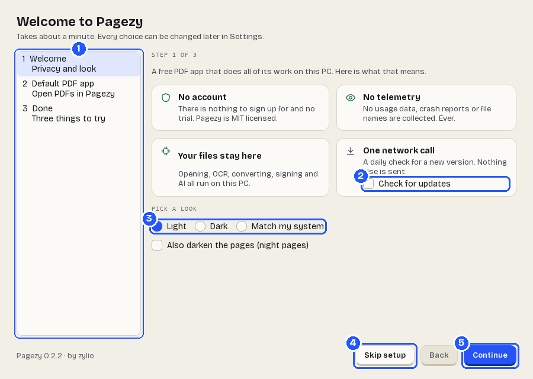

1. The three steps: **Welcome**, **Default PDF app** and **Done**.
2. **Check for updates.** Pagezy's only automatic connection is a daily check for a new version. Untick it if you'd rather check yourself.
3. **Pick a look:** **Light**, **Dark** or **Match my system**. Below it, **Also darken the pages (night pages)** shows pages light-on-dark too.
4. **Skip setup** keeps every default.
5. **Continue** goes to the next step. Step 2 helps you make Pagezy your default PDF app ([section 51](#51-settings)); step 3 shows three things to try. The last button reads **Finish**.

You can open this screen again any time: press **Ctrl+K** and type "welcome".

## 4. Home

Home is where Pagezy starts when no file is open. You can come back to it any time by clicking the Pagezy logo at the top left.

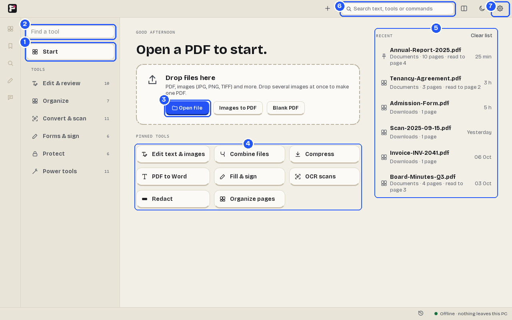

1. **Open file** (Ctrl+O) opens a PDF. Next to it, **Combine files**, **Images to PDF**, **Scan with phone** and **Blank PDF** start something new. You can also drop files anywhere on the window, or on the box on the right.
2. **Continue where you left off** shows the files you opened, each with a picture of the page you stopped on and a blue line showing how far you read. Click one to open it right where you left off. Right-click a file to **Pin to top**, **Remove from list** or **Show in folder**. **Clear list** empties the list but keeps pinned files.
3. **Tools**: the chips choose what to show. **Pinned** shows the tools you use most; the other chips show one kind of tool each.
4. **Pinned tools.** Right-click any tool and choose **Pin to Home** or **Unpin from Home**.
5. **Find a tool** searches every tool by name or description.
6. The search box opens the command palette ([section 10](#10-the-command-palette)).
7. **Settings** ([section 51](#51-settings)).

Once you save a workspace (a set of files you open together, [section 6](#6-open-save-and-close-files)), a **Workspaces** row appears under your recent files. Click one to open its files; right-click it to **Open in a new window**, **Rename…** or **Delete** it.

The chips after **Pinned** are the six kinds of tools: **Edit & review**, **Organize**, **Convert & scan**, **Forms & sign**, **Protect** and **Power tools**.

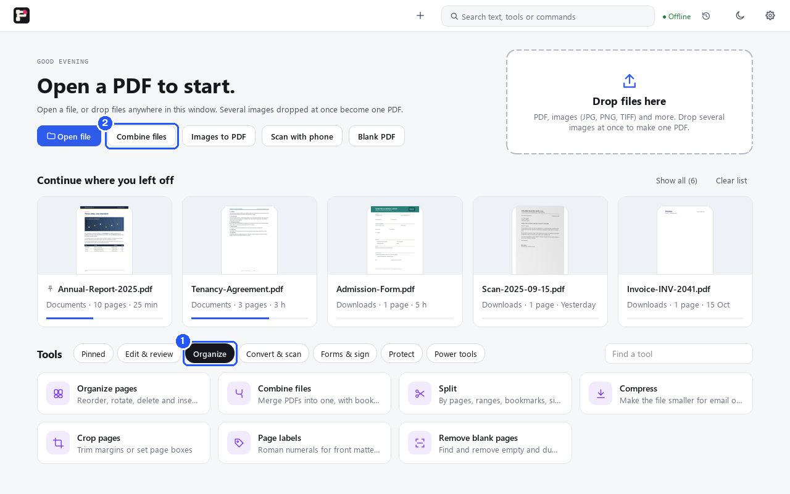

1. Click a chip to see its tools. Each tool has a one-line description; point at it to read all of it.
2. Click a tool to use it. If it needs a file and none is open, Pagezy asks you to open one first.

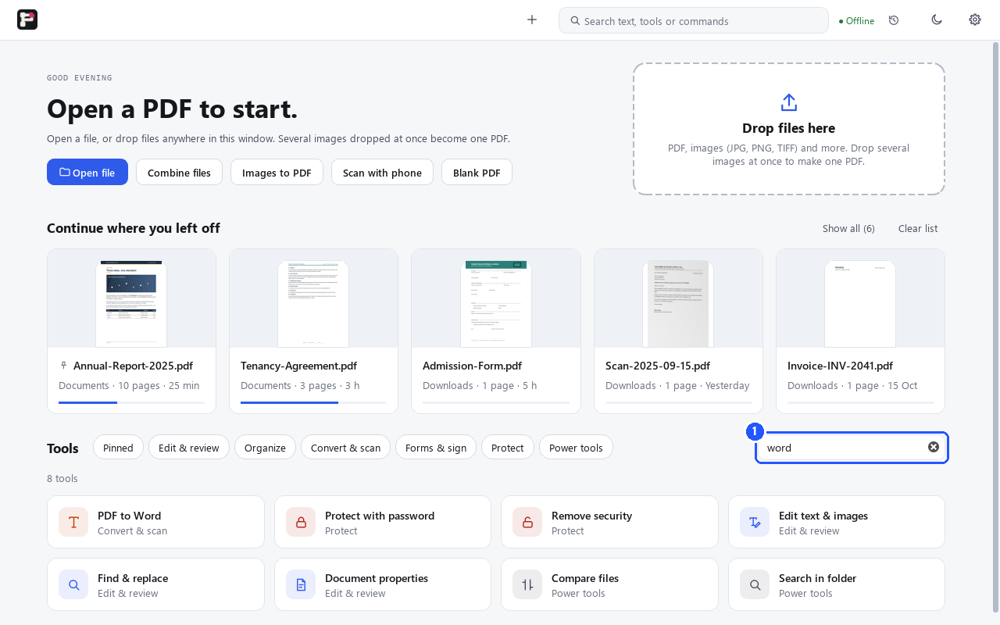

1. Type in **Find a tool**. Each result shows which group it belongs to. Clear the box to go back to your pinned tools.

The full list of tools on Home:

| Group | Tools |
|---|---|
| **Edit & review** | Edit text & images · Find & replace · Header/footer & watermark · Bates numbering · Document properties · Comment · Stamp · Measure · Export comments · Send for review · Merge comments · Compare |
| **Organize** | Organize pages · Combine files · Split · Compress · Crop pages · Page labels · Remove blank pages |
| **Convert & scan** | PDF to Word · OCR scans · PDF to Excel · Export images · Extract tables · Create PDF · Print · Enhance scans · Images to PDF · Scan with phone · Scan from scanner |
| **Forms & sign** | Fill form · Prepare form · Fill & sign · Certificate signature · Digital IDs · Validate signatures |
| **Protect** | Protect with password · Encrypt for people · Redact · Find & redact · Sanitize · Remove security · Classification label |
| **Power tools** | Compare files · Batch pipelines · Ask this PDF · Search in folder · PDF/A · Summarize · Read aloud · Preflight · Accessibility check · Command line · Share / send |

## 5. A tour of the window

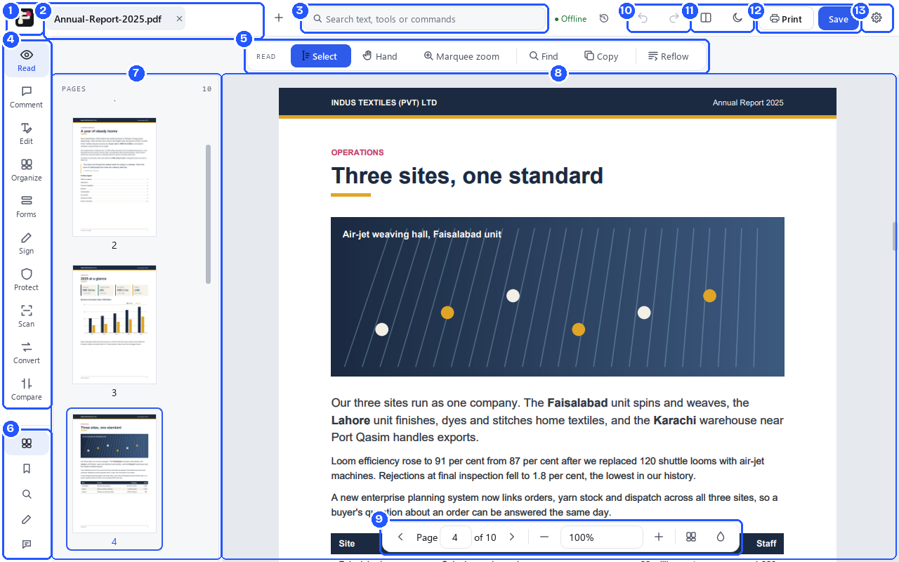

1. **The Pagezy logo** takes you to Home.
2. **Tabs.** Every open file has its own tab. A small dot means the file has unsaved changes. Drag tabs to reorder them; click **×** to close one. Drag a tab down out of the row to give it a window of its own, and right-click the tabs for **New window** and **Workspaces** ([section 6](#6-open-save-and-close-files)).
3. **The search box** opens the command palette (Ctrl+K): type any tool, command, page number or word.
4. **The mode rail.** Pagezy groups its tools into modes: **Read**, **Comment**, **Edit**, **Organize**, **Forms**, **Sign**, **Protect**, **Scan** (Scan & OCR), **Convert** and **Compare**. All tools are on Home: click the logo, or press **Ctrl+K** and type a tool's name.
5. **The toolbar** floats above the page and shows the tools of the current mode, with the mode's name at its start. On a small window, tools that don't fit go into a **More** menu at the end.
6. **Panel buttons**, under the modes, open the side panels: Pages, Bookmarks, Search, Signatures and Ask this PDF, plus Attachments and Layers when a file has them.
7. **The left panel**, here showing page thumbnails.
8. **The page area.** Messages about the file (for example "This page is a scan") appear as coloured bars across its top, and short notes such as "Saved" appear for a moment in its bottom-left corner.
9. **The page bar**, floating under the pages: page number, zoom, page layout and night pages ([section 7](#7-move-around-the-pages)).
10. **Undo** and **Redo**. In modes that have a right-hand panel, a list button just before them shows or hides it (**Ctrl+Shift+P**).
11. **Split view** and **Dark mode**.
12. **Print** and **Save**.
13. **Settings**.

Next to the search box, **● Offline** reminds you that Pagezy works without the internet: nothing leaves your PC. The clock button beside it lists background tasks.

Every change you make is one step you can undo with **Ctrl+Z** (redo with **Ctrl+Shift+Z** or **Ctrl+Y**). Nothing is written to the file until you save.

## 6. Open, save and close files

**Opening**

- Click **Open file** on Home, the **+** next to the tabs, or press **Ctrl+O**. You can pick several files at once.
- Drag files onto the window.
- Double-click a PDF in File Explorer once Pagezy is your default PDF app.
- Pick a file under **Recent** on Home, or type part of its name in the command palette.

Each file reopens at the page, zoom and layout you left it at. You can also open:

- **Pictures** (JPG, PNG, TIFF, BMP, GIF, WebP, HEIC): each becomes a new PDF. Drop two or more at once and Pagezy asks whether to **Combine into one PDF** or **Open each**.
- **Web pages and text files** (.html, .txt, .md): turned into a PDF on your PC.
- **Word, Excel and PowerPoint files**: turned into a PDF by Microsoft Office or LibreOffice if one is installed; Word files also convert without them, in a simple layout ([section 42](#42-create-a-pdf)).

**Big files** open in the background: the window keeps working, and if it takes more than a moment a card shows how far along it is, with **Cancel**. Saving a big file works the same way.

**Password-protected files.** Pagezy asks for the password in **This PDF is protected**. Tick **Show password** to see what you type. The password is only kept while the file is open, and the file keeps its protection when you save: the same open password, the same restrictions, and the author's permissions password still works, even though you only typed the open password (or none, for a file that only restricts printing or copying). To change the protection, use **Password** in Protect ([section 31](#31-passwords-and-permissions)).

**Damaged files.** Pagezy repairs them automatically when it can, and tells you with a yellow bar: "This file was damaged. Pagezy repaired it; save to keep the repaired copy." When it can't be repaired but its pages can still be shown, the file opens to read only, with the bar "Opened read-only: this file is damaged". You can read and print it, and **Save as** keeps a copy, but nothing in it can be changed.

**Saving**

- **Save** (Ctrl+S) writes your changes. Pagezy writes a temporary copy, checks it, and only then replaces the file, so a failed save never damages it.
- **Save as…** (Ctrl+Shift+S) saves a copy under a new name. To make a file for a website, pick **PDF, fast web view** under the file type (next to the file name): the first page then shows in a browser while the rest is still downloading.
- The first time you save an edited file, Pagezy keeps the untouched original beside it as `name.orig.pdf`. You can turn this off in Settings › General. After you apply redactions, Pagezy never keeps that copy, because it would still hold what you removed.
- **Signed files.** On a file with certificate signatures, Pagezy adds your changes after the signed part instead of rewriting the file, so comments, filled-in form fields and further signatures leave the signatures valid, as long as the signer allowed such changes. If your changes would still make them invalid (for example you rotated, moved or deleted pages, applied redactions, or the signer only allowed form filling and you added a comment), **Save** asks first: **Save anyway**, or **Save a copy…** to keep the signed original as it is. Redactions always rewrite the whole file, so nothing you removed stays in an earlier part of it.
- **Undo history.** Pagezy remembers up to 300 steps per file. Parts of the file a step didn't change are stored only once, so even a large scan keeps a long history.

**Closing.** Close a tab with **×** or **Ctrl+W**; Pagezy asks before closing a file with unsaved changes. **Ctrl+Tab** and **Ctrl+Shift+Tab** move between tabs, and **Ctrl+3** to **Ctrl+9** jump to tabs 3 to 9. Quit with **Ctrl+Q**. The next time you start Pagezy, it reopens the files you had open.

**More than one window.** Press **Ctrl+N** (or right-click the tabs › **New window**) to open another Pagezy window, for example to keep two files side by side on two screens.

- To move a file to a window of its own, drag its tab down out of the tab row and let go, or right-click the tab › **Move to new window**.
- To move it back, drag the tab onto the other Pagezy window, or right-click it › **Move to the window with "…"**. A window whose last tab leaves closes by itself.
- A moved file keeps its unsaved changes, its undo history and its page.
- A file is open in one window at a time: opening it again (from Home, Recent or the palette) brings up the window that already has it. Files you double-click in File Explorer open in the Pagezy window you used last.
- Closing a window asks about its unsaved files, as usual. **Quit** (Ctrl+Q) closes every window and asks just once about all the unsaved files: **Save all**, **Don't save** or **Cancel**. Next time, Pagezy reopens the files from every window, together in one window.

**Workspaces.** A workspace is a set of files you open together, such as the contract, its schedules and the letter about it. Pagezy remembers each file's page, zoom and layout, which tab was in front, and the mode you were in.

- **Save one:** right-click the tabs › **Workspaces** › **Save tabs as a workspace…**, or type "workspace" in the command palette. Give it a name and click **Save workspace**. Saving under a name you already used asks before replacing it.
- **Open one:** click it on Home, choose it under right-click the tabs › **Workspaces**, or use **Workspaces…** in the command palette. If the window has no files open, the workspace opens there; otherwise it opens in a new window.
- **Rename or delete one:** right-click it on Home, or use **Manage workspaces…**. Deleting a workspace never deletes your files.
- A workspace remembers where your files are, not their unsaved changes, so save your changes too. Files that were never saved can't be part of one. If a file has moved or been deleted since, the others still open and a note says which one is missing.

**If Pagezy or your PC stops unexpectedly**, nothing is lost: while a file has unsaved changes, Pagezy keeps a recovery copy every 30 seconds. At the next start it asks **Restore unsaved work?** Choose **Restore** to get your changes back, or **Discard**. If you just close the question, the copies are kept and offered again next time. Files protected with a password get no recovery copy, so their content is never written to disk unprotected.

---

# Part 2. Read

## 7. Move around the pages

**Read** is the mode Pagezy opens in. Its tools:

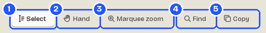

1. **Select** (the normal pointer): drag over text to select it, double-click to select a word, click a link to follow it.
2. **Hand** (**H**): drag the page around.
3. **Marquee zoom**: drag a box to zoom into it, or click to zoom in at that spot.
4. **Find** (Ctrl+F): search the text ([section 8](#8-find-text)).
5. **Copy** (Ctrl+C): copy the selected text.
6. **Reflow** (Ctrl+Shift+T): read the text flowing to fit the window ([Reflow text](#reflow-text)).

**The page bar**

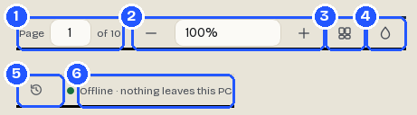

1. **Page.** Use **‹** and **›**, or type a page number (or a page label such as "iv") and press Enter. **Ctrl+G** puts the cursor here.
2. **Zoom.** Use **−** and **+**, or choose **Automatic**, **Fit width**, **Fit page**, **Actual size** or a percentage. You can type any percentage. **Automatic** (the default) fits the page to the window's width but never makes it bigger than its actual size, so pages don't blow up on a wide screen.
3. **Page layout** ([see below](#page-layouts)).
4. **Night pages** ([section 11](#11-comfortable-reading)).

**Background tasks.** Long jobs such as OCR, exports and batch runs run in the background while you keep working. The clock button at the top, next to **● Offline**, shows how many are running; click it to see their progress or cancel one.

**Keys and mouse**

| To | Press |
|---|---|
| Scroll a screen down / up | Page Down or Space / Page Up or Shift+Space |
| Next / previous page | Ctrl+Right arrow / Ctrl+Left arrow |
| First / last page | Home / End |
| Go back / forward to where you were | Alt+Left arrow / Alt+Right arrow |
| Zoom in / out | Ctrl+= (or Ctrl++) / Ctrl+-, or Ctrl + mouse wheel |
| Actual size / Fit page / Fit width | Ctrl+0 / Ctrl+1 / Ctrl+2 |
| Go to a page | Ctrl+G |
| Hand tool | H |

**Back** and **Forward** remember jumps you made with links, bookmarks, thumbnails, search results and the page box, like a web browser.

**Scrolling.** A mouse wheel glides the pages smoothly; a touchpad moves them exactly with your fingers. Zoomed in a long way (300% and more), Pagezy draws the part of the page you're looking at first and the rest as you scroll, so it stays quick. The pages just above and below are drawn ahead of time. After you change a page (a comment, an edit), only that page is drawn again; the others stay as they were.

**A page that can't be drawn.** If part of a file is damaged, that page shows **This page couldn't be drawn** instead of staying blank. The rest of the file still works. Pagezy tries the page again after it changes, for example after you repair or replace it in Organize.

**Links.** Click a link to follow it. Before opening a web link, Pagezy asks **Open link?** and shows the address. Links that would open a file or program on your PC are never followed.

### Page layouts

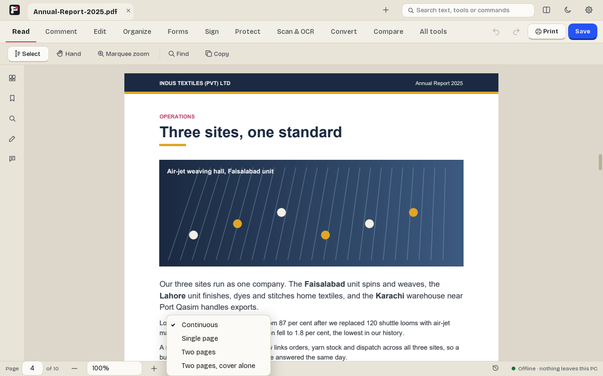

Choose how pages sit on screen:

- **Continuous**: one long scroll (the default).
- **Single page**: one page at a time.
- **Two pages**: side by side, like an open book.
- **Two pages, cover alone**: the first page on its own, then pairs, like a printed book.

The menu ends with **Reflow text** ([below](#reflow-text)).

Each file remembers its own zoom and layout. To change what new files open with, see Settings › **Page display** ([section 51](#51-settings)).

### Reflow text

**Reflow text** shows the document as flowing text, like a web page or an e-book: headings, paragraphs, lists, tables and pictures in reading order, with the words wrapping to fit the window. It's the easy way to read a PDF in a small window. Turn it on with **Reflow** in the Read tools, **Reflow text** at the end of the page layout menu, or **Ctrl+Shift+T**.

1. **Pages** (or **Esc**, or **Ctrl+Shift+T** again) goes back to the pages, at the page you were reading.
2. **−** and **+** make the text smaller or bigger. **Ctrl+-** and **Ctrl+=** do the same while you read.
3. **Line width**: **Narrow**, **Medium** or **Wide** lines.
4. **Night pages** (Ctrl+Shift+N): light text on a dark background.
5. Which page you're on. A small **— Page 3 —** line marks where each page starts.

Text in Urdu, Arabic or Hebrew reads from right to left. Long files are prepared a few pages at a time, so you can start reading straight away. Your text size and line width are remembered.

Reflow works from the text in the file, so it suits reports, articles and books more than forms, posters or drawings. A scanned page has no text to reflow until you make it searchable ([section 35](#35-make-a-scan-searchable)). Reflow is for reading: to comment or edit, go back to the pages (switching to another mode does that for you).

## 8. Find text

### The find bar

Press **Ctrl+F** (or click **Find**). If you selected a word first, it is already filled in.

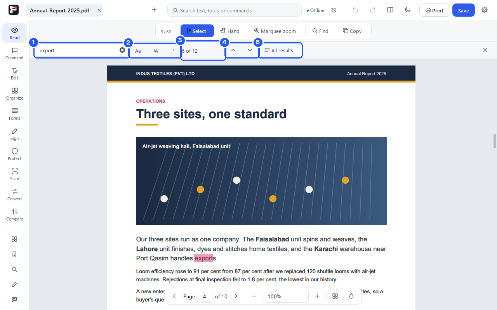

1. Type what you're looking for. Pagezy searches as you type, starting from the current page, and highlights every match. A long file is searched in the background, so you can keep scrolling; the count ends in **+** until every page has been searched.
2. **Aa** matches upper and lower case exactly, **W** finds whole words only, and **.\*** treats what you type as a regular expression (a search pattern).
3. The count, for example "6 of 12".
4. **Previous match** and **Next match**. **Enter** and **Shift+Enter** do the same, and so do **F3** and **Shift+F3** (even after the bar is closed).
5. **All results** lists every match in the Search panel.

Press **Esc** to close the bar.

Pagezy finds words the way you read them:

- A phrase that runs onto the next line is still found ("quick brown fox" with "brown" on a new line).
- A word split with a hyphen at the end of a line is found whole ("example" for "exam-" + "ple"), and **well-known** finds "wellknown" and "well-known".
- Joined letters such as fi and fl are found as ordinary letters ("office" finds "o**ffi**ce").
- Curly and straight quotes match each other, and extra spaces don't matter.
- Urdu, Arabic and Hebrew phrases are found in reading order.

While you read reflowed text ([Reflow text](#reflow-text)), **Next match** shows each match in the flowing text.

> Only real text can be found. If nothing is found on a scanned page, make it searchable first ([section 35](#35-make-a-scan-searchable)).

### The Search panel

The Search panel lists every match with the words around it. Open it with the magnifier under the modes, **Ctrl+Shift+F**, or **All results** in the find bar.

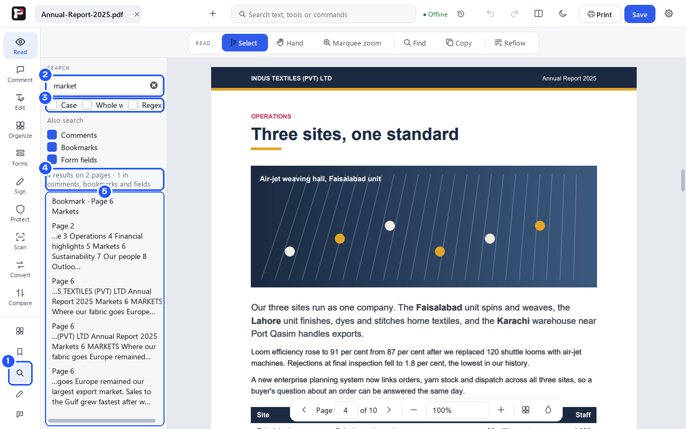

1. The **Search** panel button, under the modes.
2. Type and press Enter.
3. **Case**, **Whole word** and **Regex** work as in the find bar.
4. How many results, on how many pages.
5. The results. Click one to jump to it; **Alt+Left arrow** brings you back.

Under **Also search**, tick **Comments**, **Bookmarks** and **Form fields** to find the words in comment notes, bookmark titles and what was typed into form fields too. Those results come first in the list, marked **Comment**, **Bookmark** or **Form field**; click one to go to it. A long file is searched in the background: the panel says how many pages it has searched so far, and results appear as they are found.

To search many PDFs at once, use **Search in folder** ([section 47](#47-search-in-a-folder)).

## 9. The side panels

The panel buttons under the modes open one panel at a time. Click the same button again to close it.

**Pages** shows a thumbnail of every page. Click one to go there. (To move, rotate or delete pages, use Organize: [section 20](#20-the-page-grid).)

**Bookmarks** shows the file's table of contents.

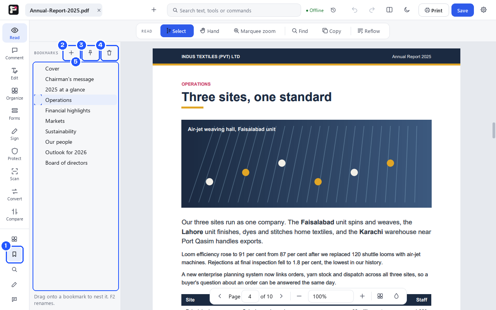

1. The **Bookmarks** panel button, under the modes.
2. **+** adds a bookmark (Ctrl+B). Select a heading on the page first and the bookmark is named after it and points at it.
3. The pin points the selected bookmark at what you're looking at now.
4. The bin deletes the selected bookmark (Delete).
5. The bookmarks. Click one to go there. **Drag** a bookmark onto another to put it inside, or between two to move it. **F2** renames it. Right-click for **Add bookmark here**, **Rename**, **Set to current view** and **Delete**.

Bookmark changes are saved with the file and can be undone.

**Attachments** appears when a file carries other files inside it. Each one shows its name, size and type, with buttons to **Open**, **Save a copy…**, **Save all…**, **Add a file…**, **Edit description…** and **Remove from file**. A PDF attachment opens in a new tab; other files open in their usual app after Pagezy asks. **Programs, scripts and macro files are never opened**: Pagezy marks them in red, and you can only save a copy. A PDF portfolio (a PDF made of several files) shows its files here too, with **Combine all PDFs into one new file**.

**Layers** appears when a file has layers, as technical drawings and maps often do. Tick or untick a layer to show or hide it. Pagezy tells you when a layer prints differently from how it looks on screen. **Reset** brings back how the file opened. Showing or hiding a layer changes how the file opens next time, so it counts as an edit you can undo.

**Signatures** lists the signatures in the file ([section 29](#29-certificate-signatures-and-digital-ids)). **Ask this PDF** answers questions about the file ([section 46](#46-ask-this-pdf-and-summarize)).

**Right-click on a page** for quick actions: **Copy** (with text selected), a **Page** menu to rotate, extract or delete the page, **Recognize text on this page**, **Zoom in**, **Zoom out** and **Fit width**. Other modes add their own items, for example **Edit this text** in Edit mode.

## 10. The command palette

The command palette finds anything in Pagezy. Press **Ctrl+K** or click the search box at the top of the window.

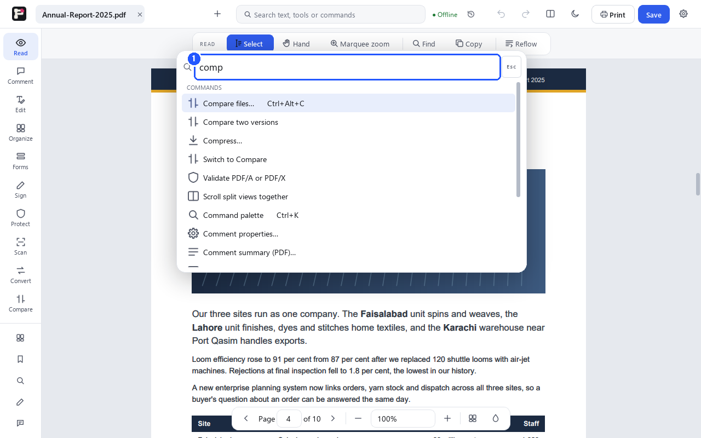

1. Type a few letters. The palette shows:
   - **Go to**: type `p 12` or `page 12` to jump to page 12.
   - **Commands**: every tool and command, with its keyboard shortcut.
   - **Recent files** whose names match.
   - **In this document**: places in the open file where the words appear (after three letters).

Use the arrow keys and **Enter** to run the highlighted item, or click it. **Esc** closes the palette.

Some commands are only in the palette, for example **About Pagezy**, **Check for updates**, **Welcome and setup**, **Set Pagezy as the default PDF app…**, **Auto-scroll**, **Scroll split views together**, **Copy file to clipboard** and **Background tasks**.

## 11. Comfortable reading

**Dark mode** (Ctrl+Shift+D, or the moon button at the top) changes Pagezy's own look.

**Night pages** (Ctrl+Shift+N, or the drop button in the page bar) also shows the pages light-on-dark: white paper becomes dark grey and black text turns light, while photos keep their real colours. It only changes what you see; printing and saving use the real colours.

**Read mode** (Ctrl+Shift+H) hides everything except the page.

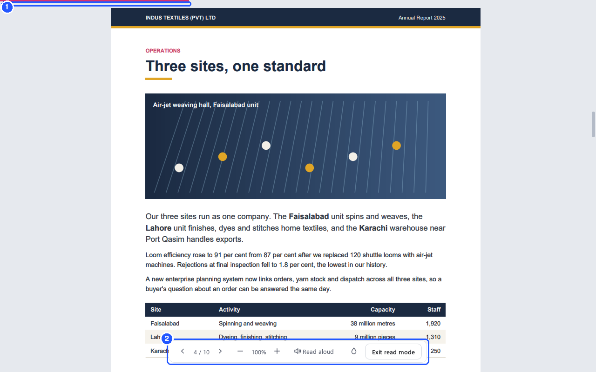

1. A thin line across the top shows how far through the file you are.
2. The floating bar: previous and next page, zoom, **Read aloud**, **Night pages** and **Exit read mode**. It fades after a moment and comes back when you move the mouse.

Press **Esc** or **Ctrl+Shift+H** to leave read mode.

**Full screen** (F11) fills the screen with the window; press **F11** or **Esc** to return.

**Present** shows one page at a time on a black screen, like a slideshow. **F5** starts from the current page, **Shift+F5** from the first page.

| While presenting | Press |
|---|---|
| Next page | Right arrow, Down arrow, Space, Enter, Page Down, or click |
| Previous page | Left arrow, Up arrow, Backspace, Page Up, or right-click |
| Jump to a page | Type its number, then Enter |
| Black screen / white screen | B / W (press again to return) |
| Stop | Esc |

To advance pages on a timer, set **Advance pages every** in Settings › **Presenting & read aloud**. **Loop** starts again after the last page.

**Read aloud** (Ctrl+Shift+Y) reads the page to you in the voices installed on your PC. A bar appears above the page with **Previous sentence**, **Play**/**Pause** and **Next sentence**, and choices for **What to read** (**This page**, **To the end** or **Selection**), **Speed** (0.8× to 2×) and **Voice**. The sentence being read is shaded, and **Follow** scrolls the page along with it. To add voices on Windows, open Windows Settings › Time & language › Speech.

**Auto-scroll** scrolls the page down slowly, like a teleprompter. Start it from the command palette. A small card offers **Slower**, **Faster** and **Stop auto-scroll**.

**Split view** (Ctrl+\\) shows two documents side by side, or two places in the same document.

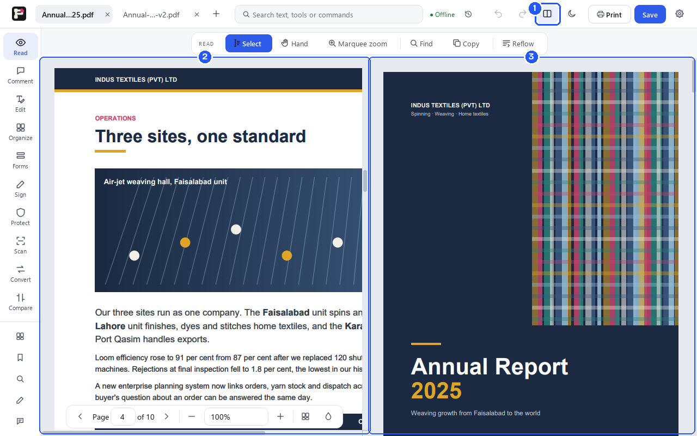

1. The **Split view** button.
2. The main pane. The toolbar and the page bar work on this one.
3. The second pane shows your other open file (or the same file again if only one is open). It scrolls and zooms on its own.

To make both panes scroll together, run **Scroll split views together** from the command palette. **Night pages** applies to both panes. Right-click the second pane to copy selected text, zoom it on its own, or **Close split view**. Click **Split view** again to close the second pane.

## 12. Document properties and sharing

**Document properties** (Alt+Enter, or Alt+Return) shows everything about the file.

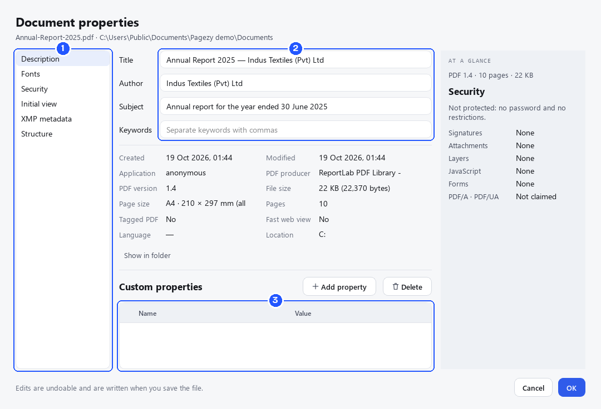

1. The sections: **Description**, **Fonts**, **Security**, **Initial view**, **XMP metadata** and **Structure**.
2. **Title**, **Author**, **Subject** and **Keywords** can be changed. Below them are facts such as the creation date, PDF version, page size and file size, and **Show in folder**.
3. **Custom properties**: your own name–value pairs. Click **Add property**.

The other sections:
- **Fonts** lists every font, and whether it is embedded. A font that isn't embedded may look different on another PC.
- **Security** shows whether the file has a password, and what is allowed: printing, changing, copying, comments, filling forms.
- **Initial view** sets how the file opens in PDF apps: with bookmarks or thumbnails showing, which page, which zoom, or full screen. **Use my current view** copies what you see now.
- **XMP metadata** and **Structure** show technical details.

On the right, **At a glance** sums up the file: pages, size, security, signatures, attachments, layers, scripts and forms. Click **OK** to keep your changes; they are saved with the file.

**Share / send** (Ctrl+Alt+S) gets a file to someone quickly.

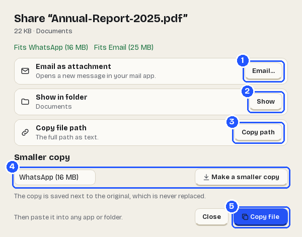

1. **Email…** opens a new message in your mail app. On Windows, Pagezy puts the file on the clipboard and shows it in its folder, so you can paste it into the message.
2. **Show** opens the file's folder.
3. **Copy path** copies where the file is saved.
4. **Smaller copy:** choose **WhatsApp (16 MB)**, **Email (25 MB)** or **Custom limit**, then **Make a smaller copy**. Pagezy first tries a copy whose pages look exactly the same. If that is still too big, it shrinks pictures, turns plain text scans into black and white, and keeps the text of colour scans sharp over a lighter background, until the copy fits. Searchable text stays searchable. The copy is saved beside the original, which is never replaced. The two lines at the top say whether the file already fits. To choose exactly how a file is made smaller, use **Compress** ([section 24](#24-make-files-smaller-and-clean-them-up)).
5. **Copy file** puts the file itself on the clipboard. Paste it into WhatsApp Desktop, an email or a folder.

**Show in folder** (Ctrl+Alt+R) opens the file's folder from anywhere.

---

# Part 3. Review

## 13. Comment

Comments are notes and marks on top of the page: highlights, sticky notes, drawings, stamps and measurements. They don't change the page itself, and other PDF apps such as Acrobat show them too. Switch to **Comment** in the mode rail (**Ctrl+Shift+C**).

Your name goes on every comment you add. Set it in Settings › **Comments** › **Author name**; if it's empty, Pagezy uses your Windows user name. Spelling is checked as you type a comment or reply: right-click a word underlined in red for suggestions ([section 51](#51-settings)).

### The comment tools

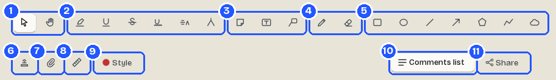

1. **Select** (V) to pick, move and resize comments, and **Hand** to drag the page.
2. **Text marks:** **Highlight** (H), **Underline** (U), **Strikethrough** (X), **Squiggly underline**, **Replace text** (R) and **Insert text** (I).
3. **Notes:** **Sticky note** (N), **Text box** (T) and **Callout** (C), a text box with a line pointing at something.
4. **Pencil** (P) to draw freehand, and **Eraser** (Shift+E) to rub out pencil strokes.
5. **Shapes:** **Rectangle**, **Oval**, **Line**, **Arrow**, **Polygon**, **Polyline** and **Cloud** (Q).
6. **Stamp** (S): Approved, Draft, Sign here and more.
7. **Attach file as comment**: a paperclip with a file stored inside the PDF.
8. **Measure** (M): distance, perimeter and area.
9. **Style**: colour, opacity and thickness.
10. **Comments list** shows or hides the list on the right.
11. **Share**: summaries, export, import and flatten.

The single letters in brackets work while the page has focus. Press a tool's letter twice to open its **Style** menu. **Esc** goes back to Select. Every comment you add, move or change is one step you can undo.

### Add comments

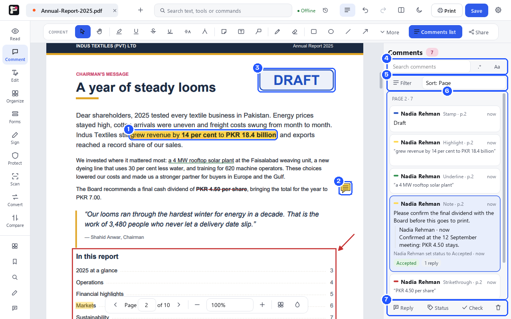

1. **Highlight, underline and strikethrough:** pick the tool and drag across the words. Double-click a single word to mark just that word. On a page with no text (a scan), drag a box instead and the whole box is marked.
2. **Sticky note:** click the page, type your note and click **Add note** (or press Ctrl+Enter).
3. **Stamp:** pick one and click the page, or drag to set its size.

The comments list on the right:

4. **Search comments** looks in the text of comments, their authors and replies. **.\*** turns on regular expressions and **Aa** matches case.
5. **Filter** by type, author, status, colour or checkmark, and **Sort** by page, author, date, type, colour, status or checkmark.
6. Every comment, grouped by page. Click one to jump to it; the selected one opens to show its replies and status history.
7. **Reply** (R), **Status**, **Check** (Space) and **Delete** for the selected comment.

The other tools:

- **Replace text:** drag across the words to replace and type the new wording. The old words are struck through with your suggestion attached.
- **Insert text:** click where something is missing and type it. A caret mark (^) shows the spot.
- **Text box:** drag a box (or just click) and type. The text shows on the page.
- **Callout:** drag from the thing you're pointing at to where the text should go.
- **Pencil:** drag to draw. Hold **Shift** for a straight line. The pencil stays on until you press Esc, and strokes drawn close together become one drawing.
- **Eraser:** drag across pencil strokes to rub out the parts you cross.
- **Shapes:** drag a box for a rectangle, oval or cloud (hold Shift for a square or circle), or drag from one end to the other for a line or arrow. For a polygon or polyline, click each corner, then press **Enter** or double-click to finish. **Backspace** removes the last point.
- **Attach file as comment:** click the page and choose a file (up to 100 MB). To get the file back, double-click the paperclip. Pagezy never opens an attached program; it only saves a copy.

**Urdu, Arabic, Hindi and other languages.** Type comments in any language. Text boxes, callouts, typewriter text and stamps show the letters joined, as they should be, in every PDF app, because Pagezy puts the letters' font in the file. Urdu is written in Nastaliq, Arabic in Naskh, and Hindi in Devanagari. Right-to-left text starts at the right of the box, and numbers and English words inside it read the right way round.

**Change a comment.** With **Select**, click a comment to select it. Drag it to move it, drag a corner to resize it, and use the arrow keys to nudge it (Shift for bigger steps). Double-click it (or press Enter) to edit its text. **Delete** removes it.

**Comments made in other apps**, such as Acrobat, keep their own look when you move or resize them. When you change their text, Pagezy updates it everywhere it is stored, so Acrobat shows your new words too.

**Right-click a comment** (in any mode) for **Reply…**, **Set status** (Accepted, Rejected, Cancelled, Completed), **Mark with checkmark**, **Edit text…**, **Copy text**, **Lock**, **Properties…** and **Delete**. A locked comment can't be moved, resized or deleted until you unlock it.

**Replies and status** are how a review works: each reviewer replies under a comment and sets its status, and every reply carries the reviewer's name. Checkmarks are your own private ticks for keeping track.

### Stamps

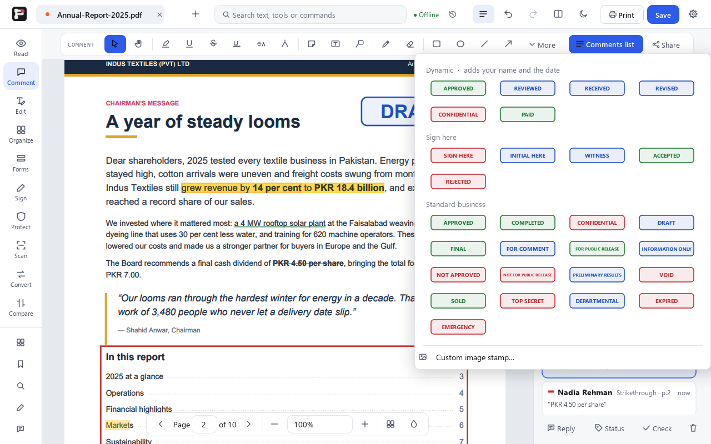

Click **Stamp** to pick one:

- **Dynamic** stamps add your name and the date and time: Approved, Reviewed, Received, Revised, Confidential, Paid.
- **Sign here** stamps: Sign Here, Initial Here, Witness, Accepted, Rejected.
- **Standard business** stamps: Approved, Completed, Confidential, Draft, Final, For Comment, Void and more.
- **Custom image stamp…** turns any picture (a company seal, a logo) into a stamp. Transparent PNGs stay transparent. Your custom stamps are listed in this menu from then on.

### Colour, opacity and thickness

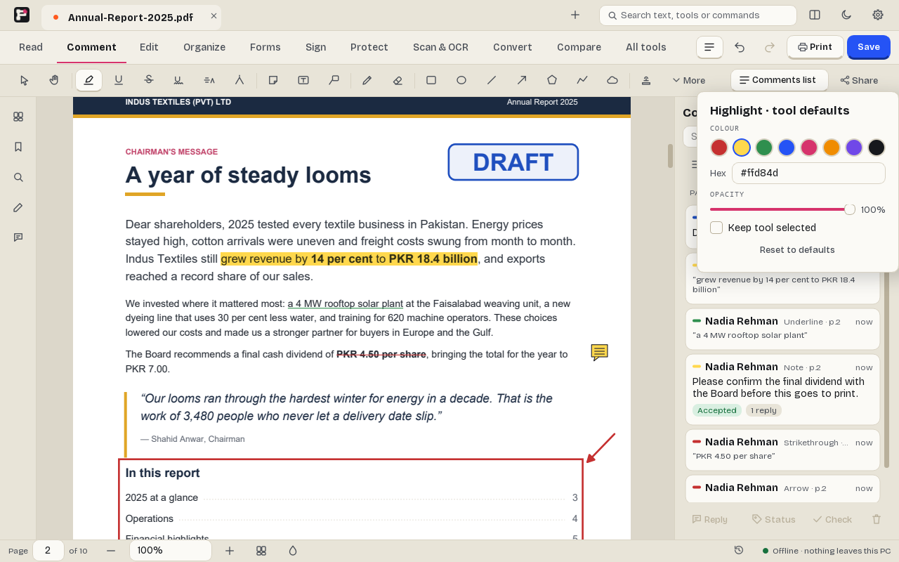

Click **Style** to change:

- **Colour**: eight swatches, or type a colour code under **Hex**.
- **Opacity**: from 10% to 100%.
- **Thickness** of lines and borders, and **Smoothing** for the pencil.

With a comment selected, the changes apply to that comment. With nothing selected, they become the defaults for the current tool and are remembered. **Keep tool selected** keeps the tool on after each comment, instead of going back to Select. **Reset to defaults** undoes your style for that tool.

For more, right-click a comment and choose **Properties…**:

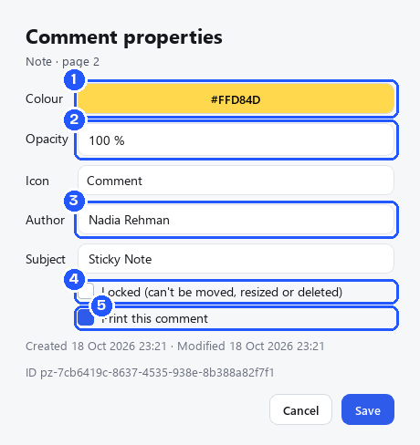

1. **Colour** (and **Fill** for shapes and text boxes).
2. **Opacity.**
3. **Author** and **Subject.** Text boxes also have **Font size** and **Text colour**, and notes have an **Icon**.
4. **Locked** stops the comment from being moved, resized or deleted.
5. **Print this comment.** When it's off, the comment isn't printed or flattened.

### Measure

**Measure** (M) works out real distances and areas on drawings and plans.

The first time, Pagezy asks for the drawing's scale:

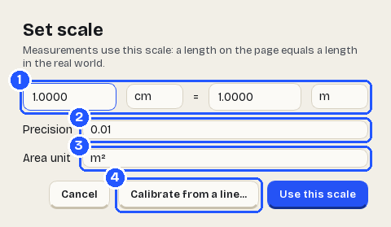

1. The scale: a length on the page equals a length in the real world, for example **1 cm = 1 m**.
2. **Precision**: how many decimal places to show.
3. **Area unit**, including acres, hectares, marla and kanal.
4. **Calibrate from a line…**: drag along something whose real length you know, then type that length. Pagezy works out the scale for you.

Then choose a tool from the **Measure** menu:
- **Distance:** drag from one end to the other. The length appears on the line.
- **Perimeter:** click each point, then press Enter.
- **Area:** click each corner, then press Enter or click the first point.

The value shows in the bottom-left corner of the page area while you draw. **Export measurements (CSV)…** in the same menu saves every measurement for Excel.

### Share comments

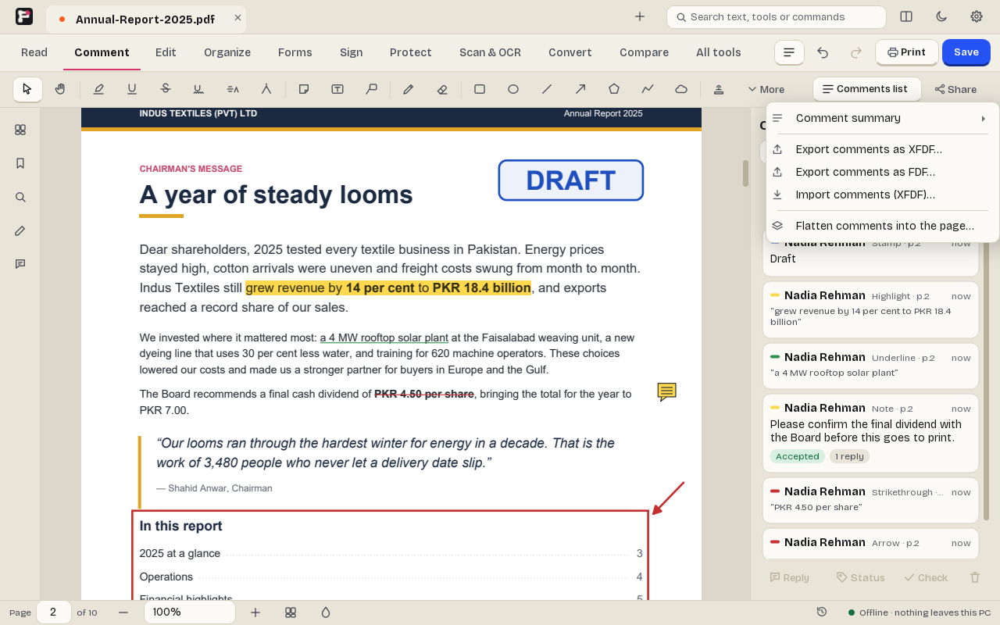

- **Comment summary** › **PDF…**, **Markdown…** or **CSV (Excel)…** saves every comment with its replies, page by page. If the list is filtered, Pagezy asks whether to include only the comments shown. (For Urdu or Arabic comments, use Markdown or CSV.)
- **Export comments as XFDF…** and **Export comments as FDF…** save just the comments, so you can send them without the PDF. Acrobat can import them.
- **Import comments (XFDF)…** brings in a reviewer's comments. Comments you already have are skipped, so importing twice is safe.
- **Flatten comments into the page…** draws every comment into the page itself. They can no longer be edited, but Ctrl+Z brings them back until you save.

### Send for review and merge comments

When several people need to comment on a file, Pagezy prepares the copies and gathers the comments back. There is no server and nothing is sent for you: you pass the copies around with your own email or file sharing, and your reviewers can use any PDF app (Pagezy, Acrobat Reader, Edge, Chrome or Preview).

**Send for review** (Home › Edit & review, or the command palette):

1. Type each reviewer's **Name** (the email is optional, for your own list). **Add reviewer** and **Remove reviewer** change the list.
2. Tick **Ask for comments by** to give a date.
3. Change the **Instructions** if you like. Each copy opens with them in a note on the first page.
4. **Saves the copies in** shows the folder (a new "… - review copies" folder beside your file); **Change…** picks another.
5. Click **Create review copies**. You get one copy per reviewer, named after them, and a **How to review.txt** file that lists who gets which copy and what to do. **Show in folder** opens the folder so you can send them.

The copies are made from the file as it is now, including changes you haven't saved. A password-protected file can't be sent for review, because the copies would have no password; remove it first if you need to.

**Merge comments** (Home › Edit & review, or the command palette) brings the comments back into the open file. Choose the copies that came back; you can pick several at once, and a file of comments a reviewer exported from their app (XFDF) works too. Pagezy then shows:

- **Who said what**: each reviewer, with every new comment, the page it's on and the words it marks. Comments that came back without a name get the name of the person the copy was for.
- **Check these**: places that need your decision, in warning colour. Two people asked for different changes to the same words; two people changed one of your existing comments in different ways (Pagezy leaves it as it is); or someone changed the page itself rather than commenting on it (only comments are merged, so compare the files to see the change, [section 14](#14-compare-two-versions)).
- Notes such as **Still waiting for:** the reviewers whose copy hasn't come back, or that the file has changed since the copies were made.

Click the **Merge** button (it says how many comments, for example **Merge 12 comments**) to add them all as one step: Ctrl+Z takes them out again. Pagezy switches to **Comment** so you can go through them, reply and set their status. Comments already in your file are skipped, so merging the same copy twice is safe.

## 14. Compare two versions

Compare shows every word that was added, removed, changed or moved between two versions of a document, side by side. It also finds changes to formatting (font, size, bold, italic and colour), comments, pictures and pages. Switch to **Compare** in the mode rail, or press **Ctrl+Alt+C**.

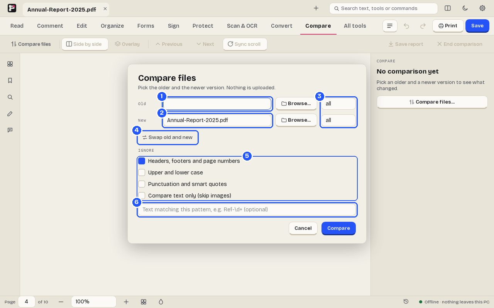

1. **Old**: the earlier version. Pick an open file, or **Browse…** for one on your PC.
2. **New**: the later version.
3. Which pages to compare: **all**, or a range such as `1-5, 8`.
4. **Swap old and new**.
5. What to ignore: **Headers, footers and page numbers** (on by default), **Upper and lower case**, **Punctuation and smart quotes**, **Formatting (font, size, bold, italic, colour)**, and **Compare text only (skip images)**.
6. An optional pattern: text that matches it is ignored, for example reference numbers.

Click **Compare**. While it works, the panel on the right shows how far it has got, and **Stop comparing** cancels it. Long files are quick too: two 200-page versions take a few seconds, and comparing the same files again is almost instant.

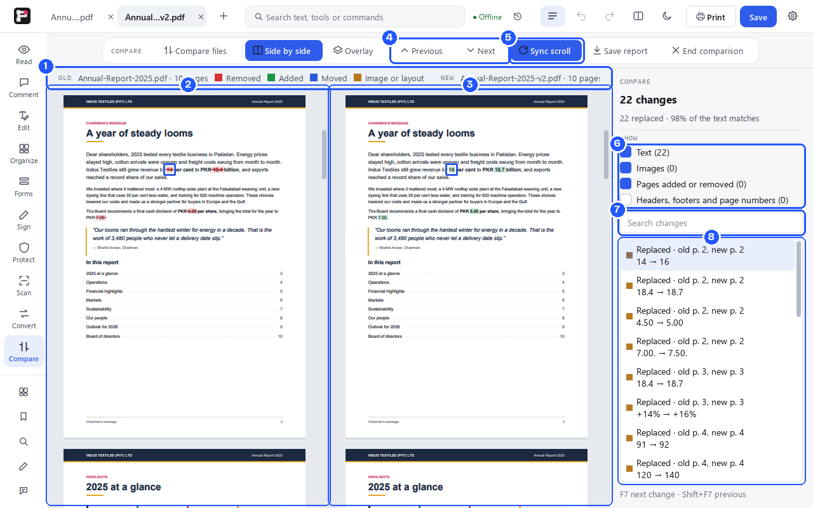

1. The colour key: **Removed** (red), **Added** (green), **Moved** (blue), **Formatting** (purple) and **Image or comment** (amber). On a narrow window the key is hidden to make room.
2. The old version, on the left, with the page it shows (for example *page 8 of 30*).
3. The new version, on the right, with its page. Changed words are marked on both sides, and the current change is outlined.
4. **Previous** and **Next** change (**Shift+F7** and **F7**).
5. **Sync scroll** keeps both sides on the same place, even when pages were added or removed.
6. **Show**: turn whole kinds of change on or off. The number after each kind says how many there are:
   - **Text added, removed or replaced**.
   - **Moved text**: a paragraph that now sits somewhere else.
   - **Formatting (font, size, bold, colour)**: the same words in a different font, size, weight, slant or colour. The list says what changed, for example *bold* or *size 10 → 12 pt*.
   - **Comments**: notes and markups that were added, removed or changed (their text, author, colour, status, replies or place).
   - **Images**: pictures added, removed, replaced by a different one, or moved or resized.
   - **Pages added, removed or moved**: a page that moved shows as *old page 3 is now page 6*.
   - **Headers, footers and page numbers** (off by default).
7. **Search changes** for a word.
8. Every change, with its pages. Click one to jump there. Point at one to see the old and new text.

**Overlay** compares the two pages pixel by pixel, which suits drawings, maps and scans:

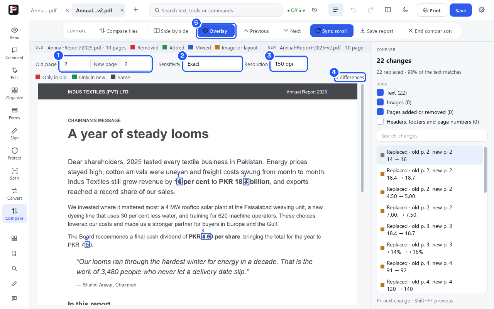

1. **Old page** and **New page**.
2. **Sensitivity**: **Exact**, or ignore shifts of 1 to 4 pixels.
3. **Resolution**: 100, 150 or 200 dpi.
4. How many areas differ. Pixels only in the old page show red, only in the new page green, and the same in grey. If the new page is slightly shifted, Pagezy lines it up first.
5. **Overlay** and **Side by side** switch between the two views.

**Save report** writes a record of the comparison:

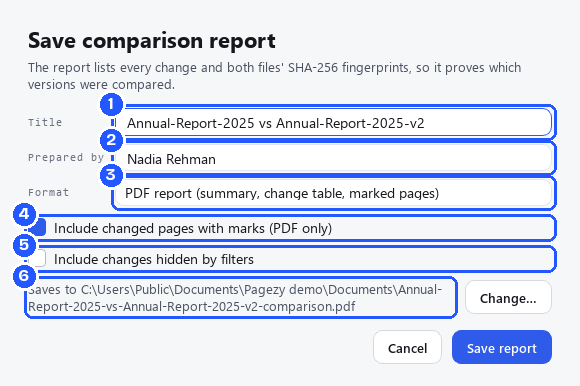

1. **Title**.
2. **Prepared by**.
3. **Format**: a PDF report (summary, table of changes and marked pages), Markdown, or CSV (changes only).
4. **Include changed pages with marks (PDF only)**.
5. **Include changes hidden by filters**.
6. Where it's saved; **Change…** to choose.

Every kind of change goes into the report, with a column that says what changed (for example *bold*, *text changed* or *reply added*). The report lists both files' SHA-256 fingerprints, which prove exactly which versions were compared. **End comparison** closes the comparison.

---

# Part 4. Edit

## 15. Edit text and pictures

Switch to **Edit** in the mode rail (**Ctrl+Shift+E**) to change the words and pictures on the page itself.

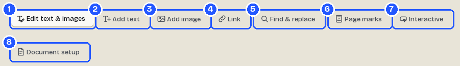

1. **Edit text & images** (E): click any text or picture to change it.
2. **Add text** (T).
3. **Add image**.
4. **Link** (L): add or change links ([section 16](#16-links-find-and-replace)).
5. **Find & replace** (Ctrl+H).
6. **Page marks**: header and footer, watermark, background and Bates numbers ([section 17](#17-headers-footers-watermarks-and-bates-numbers)).
7. **Interactive**: scripts in the file ([section 18](#18-document-setup-scripts-and-bookmarks)).
8. **Document setup** (Ctrl+D).

The panel on the right lists the **Fonts in this file** and what Pagezy can do with each: **Edits natively**, use a substitute for new letters, or **Cover & replace only**.

### Change text

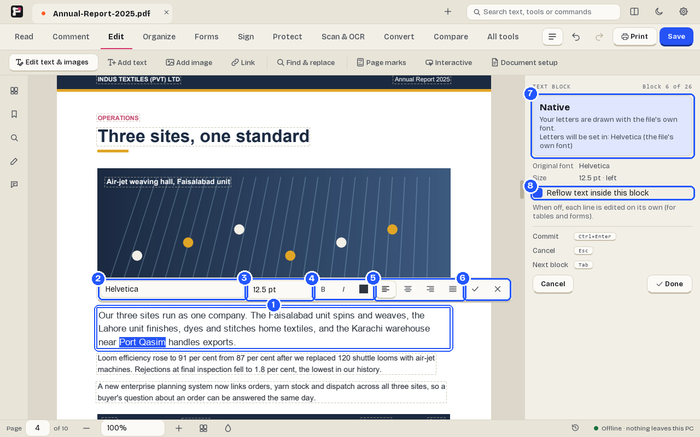

1. Click a text block. It opens with a blue border. Type to change it; the text wraps inside the block.
2. **Font**: the block's own font, the other fonts in the file, and fonts installed on your PC.
3. **Size.**
4. **Bold** (Ctrl+B), **Italic** (Ctrl+I) and **Text colour**.
5. **Align** left, centre, right or justified.
6. **Done** (Ctrl+Enter) keeps the change; **Cancel** (Esc) throws it away. Clicking outside the block also keeps it, and **Tab** keeps it and opens the next block.
7. Which font will draw your letters.
8. **Reflow text inside this block.** Turn it off to edit each line on its own, which suits tables and forms.

The look you choose applies to the whole block.

**How Pagezy keeps your edit looking right.** It tries three things, in order, and checks the result each time:

- **Native:** your letters are drawn with the file's own font, so the edit is invisible.
- **Substitute:** if the file's font lacks a letter you typed, a matching font from your PC draws it.
- **Cover & replace:** for the rare text that can't be removed safely, Pagezy hides the old text under a box in the paper's colour and draws yours on top. The old text is still in the file; to remove it for good, redact it ([section 32](#32-redact)). You can turn this off in Settings › **Editing**.

After you save an edit, the panel says which of the three was used.

**Urdu, Arabic and Hindi.** You can type these into any block, or change a block that's already in them. Pagezy writes the whole block again with its letters joined: Urdu in Nastaliq, Arabic in Naskh and Hindi in Devanagari, using fonts built into Pagezy, so you don't need to install anything. If you pick a font on your PC that is made for the language (for example Jameel Noori Nastaleeq), Pagezy uses it instead. Right-to-left paragraphs start at the right, and lines wrap between words. The text can still be searched and copied afterwards.

### Add text

Press **T** (or click **Add text**), then click where the text should go. To get text that wraps, drag sideways to set its width. Type, format it with the same bar, and click **Done**. New text uses the font and size you last used in that file.

### Pictures

Click a picture with **Edit text & images** to select it.

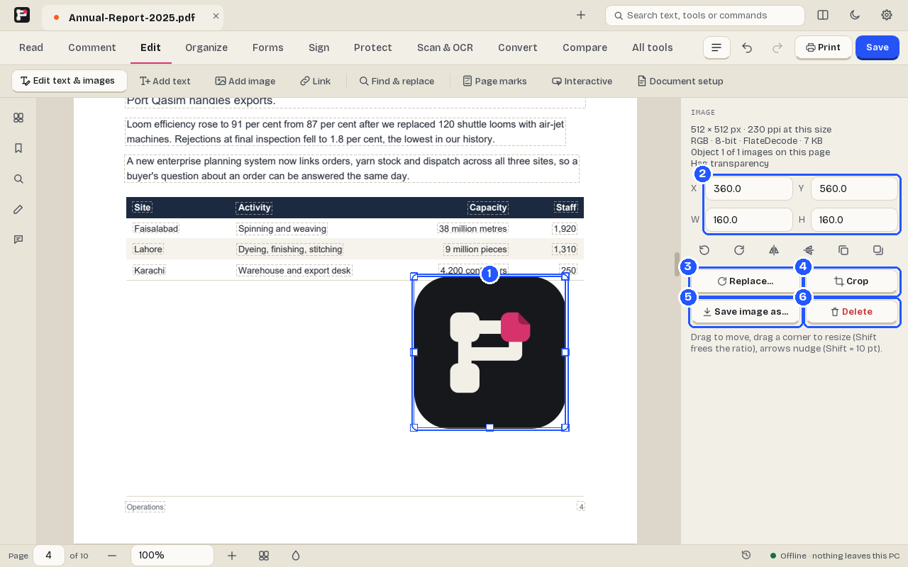

1. The picture, with its handles. Drag it to move it; drag a corner to resize it (hold **Shift** to stretch it), or an edge to stretch one way. The arrow keys nudge it.
2. **X**, **Y**, **W** and **H**: its exact place and size, in points from the top-left of the page. Below them: **Rotate left**, **Rotate right**, **Flip horizontally**, **Flip vertically**, **Bring to front** and **Send to back**.
3. **Replace…** puts another picture in its place, fitted to the same box.
4. **Crop**: drag over the part to keep and press **Enter**. The cut-off part is really removed.
5. **Save image as…** saves the picture as PNG, JPEG or TIFF.
6. **Delete** (or the Delete key).

The panel also shows the picture's size in pixels and its resolution at the size it's printed.

**Add image:** click **Add image**, choose a picture, then click the page to place it at its own size, or drag a box to fit it.

## 16. Links, find and replace

### Links

Press **L** (or click **Link**). Existing links show dashed boxes. Drag a box over the text or area that should be clickable. (Or select the text first, then click **Link**.)

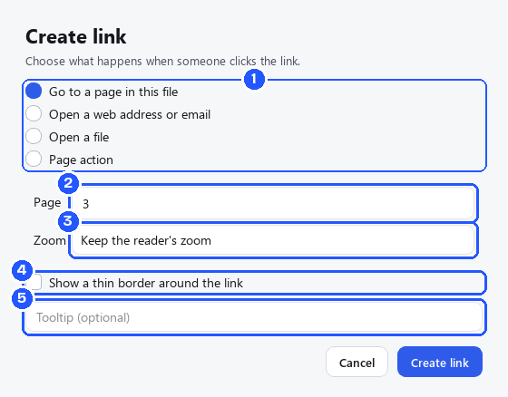

1. What happens on click: **Go to a page in this file**, **Open a web address or email**, **Open a file**, or a **Page action** (next, previous, first or last page).
2. **Page**: which page to go to.
3. **Zoom**: **Keep the reader's zoom**, **Fit the page** or **Fit the width**.
4. **Show a thin border around the link**.
5. **Tooltip (optional)**: text shown when someone points at the link.

Click **Create link**. To change a link, click it with the Link tool on, then **Change…**, **Test** or **Delete** in the panel. Only web (http, https) and email links can be made; links to programs are refused because they're unsafe.

In the same panel:
- **Link web addresses…** finds web and email addresses in the text that aren't links yet, so you can review them and turn them into links in one step.
- **Remove links…** takes links off the pages you choose, by kind, without touching the text.

### Find and replace

Press **Ctrl+H** (or click **Find & replace**).

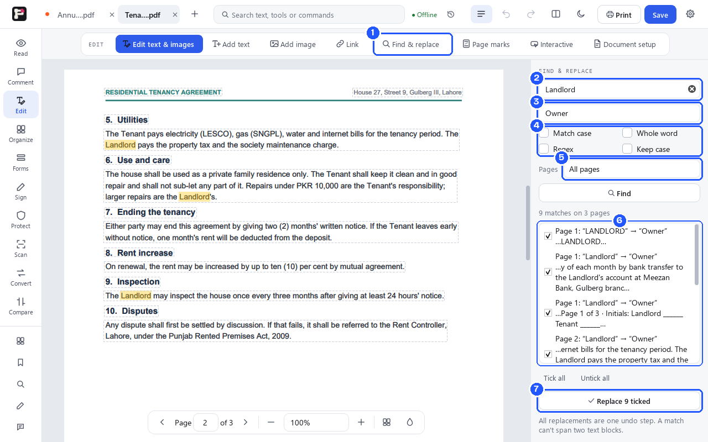

1. **Find & replace** in the toolbar.
2. **Find**: the words to look for.
3. **Replace with**.
4. **Match case**, **Whole word**, **Regex**, and **Keep case** (which keeps capitals as they were: fifth → tenth, Fifth → Tenth, FIFTH → TENTH).
5. **Pages**: **All pages** or **Current page**.
6. Every match, with the words around it, ticked. Click a match to see it on the page. Untick any you want to leave alone.
7. **Replace ticked**: all the replacements become one step you can undo.

## 17. Headers, footers, watermarks and Bates numbers

Click **Page marks** in Edit. Every mark Pagezy adds is tagged, so it can be changed or removed later with **Remove marks…**. Marks added by Acrobat can be removed the same way.

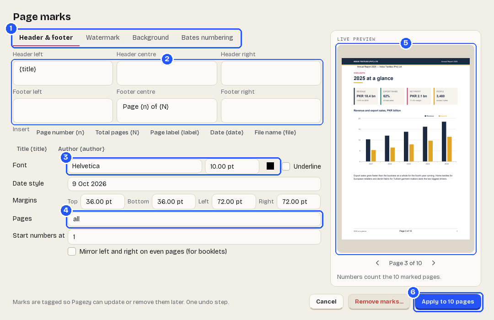

1. The four kinds of mark: **Header & footer**, **Watermark**, **Background** and **Bates numbering**.
2. Six boxes: left, centre and right, at the top and bottom. Click one of the **Insert** buttons below them to add a page number `{n}`, the total pages `{N}`, a page label, the date, the file name, the title or the author. The footer starts as "Page {n} of {N}".
3. **Font**, size and colour. Below them: **Date style**, **Margins**, and **Mirror left and right on even pages (for booklets)**.
4. **Pages**: `all`, `odd`, `even`, or ranges such as `2-6`, `1,3,5` or `5-` (to the end). **Start numbers at** sets the first number.
5. **Live preview** of the real page. Use the arrows to look at other pages.
6. **Apply to 10 pages**.

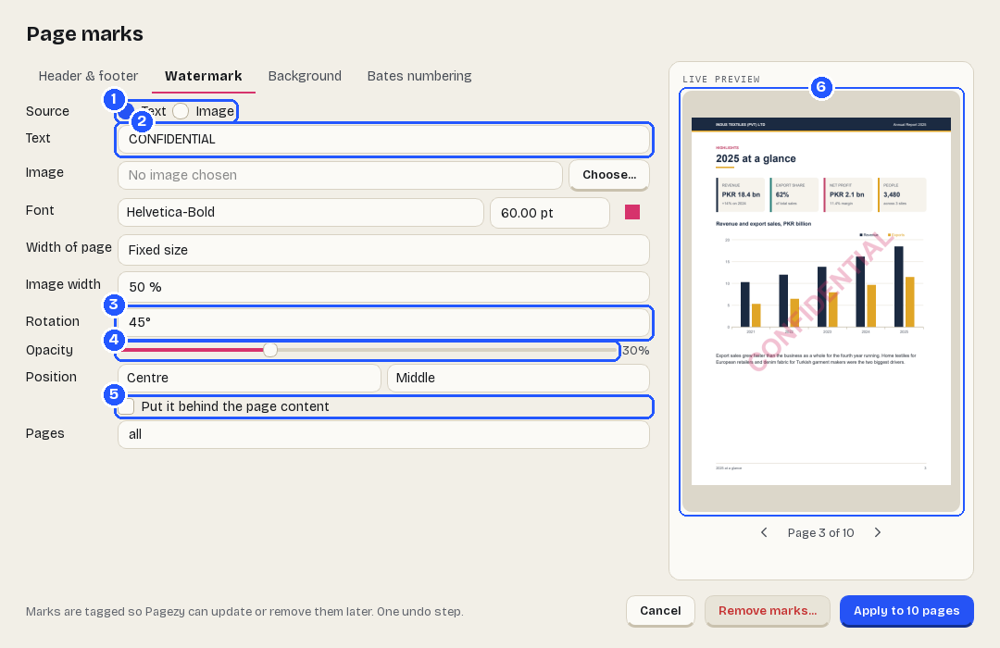

1. **Source**: **Text** or **Image**.
2. The watermark text (or **Choose…** a picture). It can use the same `{…}` codes.
3. **Rotation**: 45°, 0°, 90°, −45°, or any angle you type.
4. **Opacity**.
5. **Put it behind the page content**, so the text stays on top.
6. **Live preview.**

You can also set the font, size, colour, width and position. **Background** puts a colour or a picture behind everything on the page.

Headers, footers and watermarks can be in Urdu, Arabic, Hindi or any other language. Pagezy joins the letters and puts the font in the file, so the mark looks the same everywhere and can be searched.

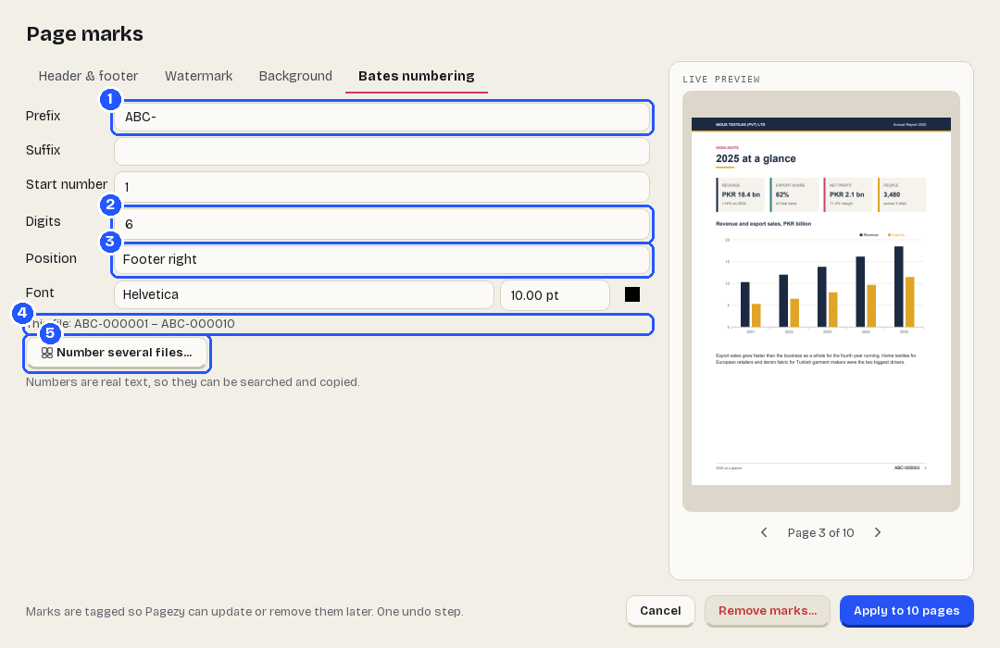

1. **Prefix** (and **Suffix**), for example `ABC-`.
2. **Digits**: how many digits, from 6 to 15.
3. **Position**: any of the six header and footer places.
4. The numbers this file will get.
5. **Number several files…** numbers a whole set of files in one sequence, in the order you choose. The originals stay unchanged; numbered copies go to the folder you pick, and a log (`bates-log.csv`) lists the numbers each file got.

Bates numbers are real text, so they can be searched and copied.

## 18. Document setup, scripts and bookmarks

**Document setup** (Ctrl+D) edits how the file describes itself:

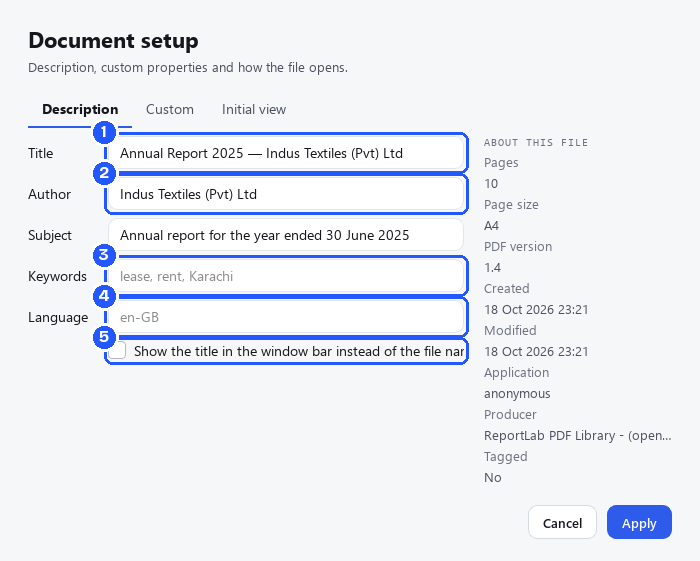

1. **Title**.
2. **Author**.
3. **Keywords**.
4. **Language**, for example `en-GB`. Screen readers use it.
5. **Show the title in the window bar instead of the file name**.

The **Custom** tab holds your own properties, and **Initial view** sets how the file opens in PDF apps: which panel shows, the page layout, which page and the zoom.

**Interactive** shows the scripts inside the file. Pagezy never runs PDF scripts; this window tells you in plain words what each one would try to do (for example "Sends data or opens a web address"), marks it **Risky**, **Check** or **Harmless**, and shows its code. **Remove all blocked scripts** takes them out and keeps the harmless standard form helpers.

**Bookmarks** are edited in the Bookmarks panel ([section 9](#9-the-side-panels)). Select a heading and press **Ctrl+B** to add one.

## 19. Edit the words on a scanned page

A scan is a picture of a page, so its words can't normally be edited. Pagezy can turn them into real text.

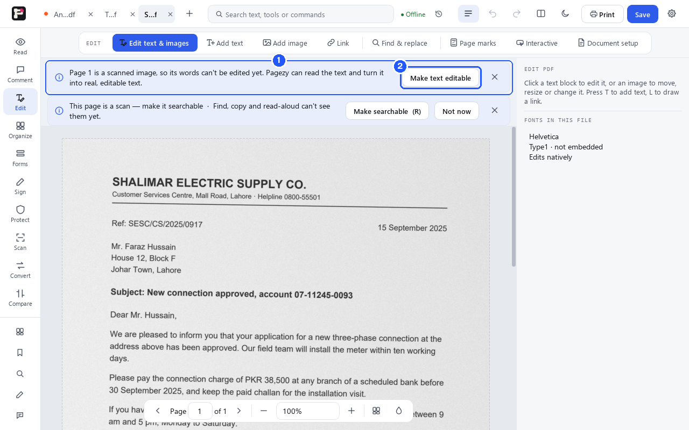

1. When you open Edit on a file with scanned pages, a blue bar tells you.
2. Click **Make text editable**. With several scanned pages, choose **This page** or **All pages**.

Pagezy reads the text (if it hasn't been read yet), straightens slightly crooked pages, turns every line into real text in a matching font, and removes the old letters from the picture. Stamps, signatures and photos stay as they were. Then click any line with **Edit text & images** to change it, as in [section 15](#15-edit-text-and-pictures). The whole conversion is one step you can undo.

You can also right-click a scanned page and choose **Make this page's text editable**.

The matched fonts are standard faces, so the text looks close to the original but not identical. Urdu, Arabic and Hindi lines (read with Tesseract, [section 35](#35-make-a-scan-searchable)) come back as joined text in Nastaliq, Naskh or Devanagari, sized to fit the line on the scan.

---

# Part 5. Organize pages and files

## 20. The page grid

Switch to **Organize** in the mode rail (**Ctrl+Shift+O**). Every page appears as a thumbnail.

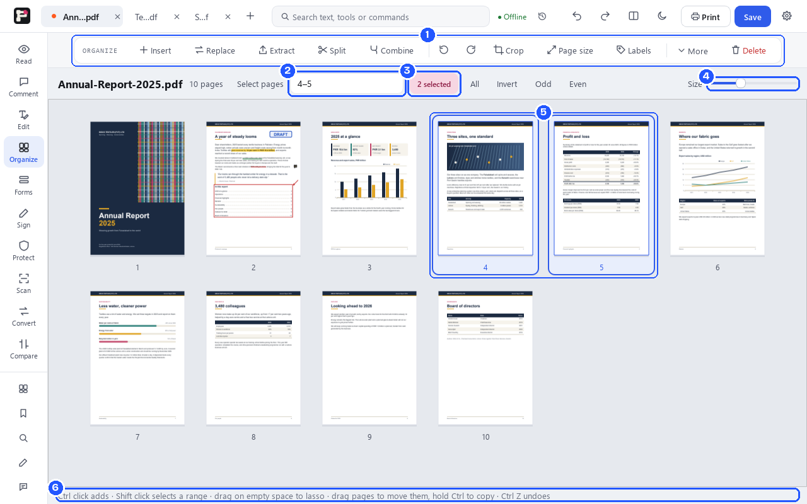

1. **The Organize tools:** **Insert**, **Replace**, **Extract**, **Split**, **Combine**, **Rotate left** and **Rotate right**, **Crop**, **Page size**, **Labels**, **Compress**, **Clean up** and **Delete**.
2. **Select pages** by typing, for example `2-5, 9`, `odd`, `even`, `last` or `all`. The grid follows as you type.
3. How many pages are selected. **All**, **Invert**, **Odd** and **Even** are quick selections.
4. **Size** makes the thumbnails bigger or smaller (or hold Ctrl and turn the mouse wheel).
5. Selected pages are outlined.
6. A reminder of what the mouse does.

**Selecting.** Click a page. **Ctrl**+click adds or removes one; **Shift**+click selects a range; drag on empty space to draw a box around pages. **Ctrl+A** selects all. When nothing is selected, the tools work on the page you last clicked.

**Moving and copying.** Drag selected pages to a new place; a blue bar shows where they'll go. Hold **Ctrl** while you drop to copy them instead. **Alt+Left arrow** and **Alt+Right arrow** move the selection one place, and **Ctrl+M** moves it before a page number you type. You can also drop PDF files from File Explorer onto the grid to insert their pages there.

**Keys in the grid**

| To | Press |
|---|---|
| Rotate left / right | [ / ] |
| Delete | Delete |
| Duplicate | Ctrl+D |
| Extract | Ctrl+E |
| Insert pages from a file | Ctrl+I |
| Insert a blank page after this one | Ctrl+Shift+T |
| Crop | C |
| Open the page in Read mode | Enter, or double-click |

(Outside the grid, Ctrl+E is Export and Ctrl+D is Document setup.)

Rotating never changes a page's content, only which way up it is. Every change is one step you can undo.

**Right-click selected pages** for every page action in one menu:

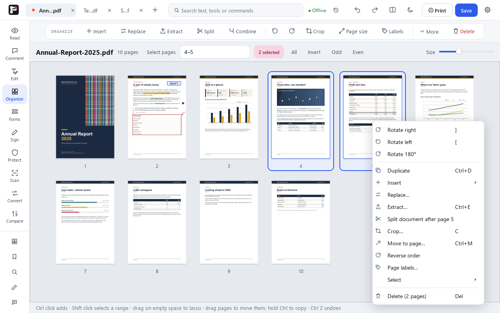

It has **Rotate right**, **Rotate left**, **Rotate 180°**, **Duplicate**, **Insert**, **Replace…**, **Extract…**, **Split document after page N**, **Crop…**, **Move to page…**, **Reverse order**, **Page labels…**, **Select** (all, odd, even, landscape, portrait, pages containing some text, or pages with comments) and **Delete**. Pagezy won't delete every page: a PDF needs at least one.

In any other mode, right-click a page and use the **Page** menu to rotate, extract or delete just that page.

## 21. Insert, replace and extract pages

**Insert** › **Pages from a file or tab…** (Ctrl+I):

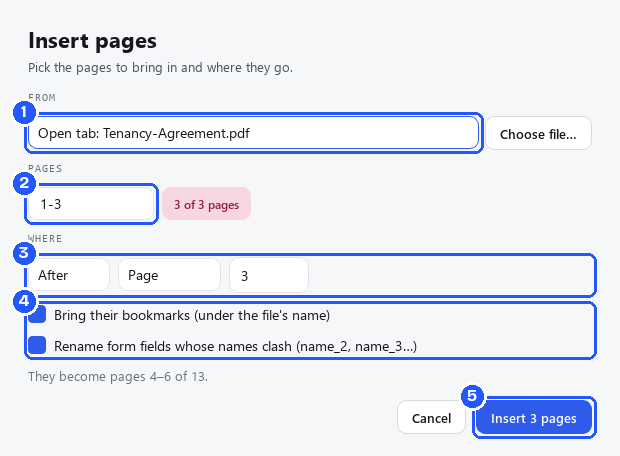

1. **From**: one of your open tabs, or **Choose file…**.
2. **Pages** to bring in, for example `1-3`. They come in the order you type, so `3-1` brings them in backwards.
3. **Where**: **Before** or **After** a page, or the first or last page.
4. **Bring their bookmarks (under the file's name)** and **Rename form fields whose names clash**.
5. **Insert 3 pages**.

**Insert** › **Blank page after this one** (Ctrl+Shift+T) adds one right away. **Blank pages…** gives more choice:

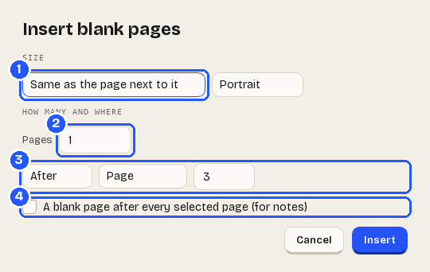

1. **Size**: the same as the page next to it, a standard size such as A4 or Letter, or a custom size. Choose **Portrait** or **Landscape**.
2. **Pages**: how many.
3. **Where** they go.
4. **A blank page after every selected page (for notes)**.

**Replace** swaps the selected pages for pages from another file. Bookmarks and links that pointed at the old pages open the new ones. The number of pages must match.

**Extract** copies pages out into a new PDF:

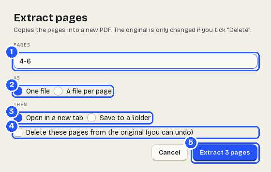

1. **Pages** to extract.
2. **As**: **One file**, or **A file per page**.
3. **Then**: **Open in a new tab**, or **Save to a folder**.
4. **Delete these pages from the original (you can undo)**. Leave it unticked to copy them.
5. **Extract 3 pages**.

**Reverse order** reverses the selected pages (or the whole file). **Duplicate** puts a copy right after each selected page.

## 22. Combine and split files

**Combine** merges several files into one PDF. It works even with no file open: Home › Organize › **Combine files**.

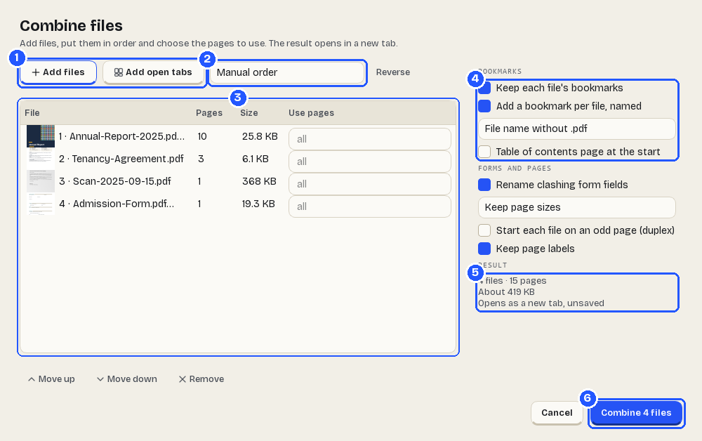

1. **Add files** (you can choose many at once) and **Add open tabs**.
2. Put them in order: drag them, use **Move up** and **Move down**, or sort by **Name A–Z**, **Name, natural (2 before 10)**, **Date modified** or **Size**. **Reverse** flips the order.
3. The files. In **Use pages** you can type which pages to take from each one; leave it empty for all.
4. **Bookmarks**: keep each file's own bookmarks, add one bookmark per file (named after the file or its title), and add a **Table of contents page at the start**.
5. What you'll get: how many files and pages, and roughly how big. Also choose whether to **Rename clashing form fields**, resize every page to A4 or Letter, **Start each file on an odd page (duplex)** for double-sided printing, and keep page labels.
6. **Combine 4 files**. The result opens in a new tab; save it to keep it.

**Split** cuts a file into several. The original is never changed.

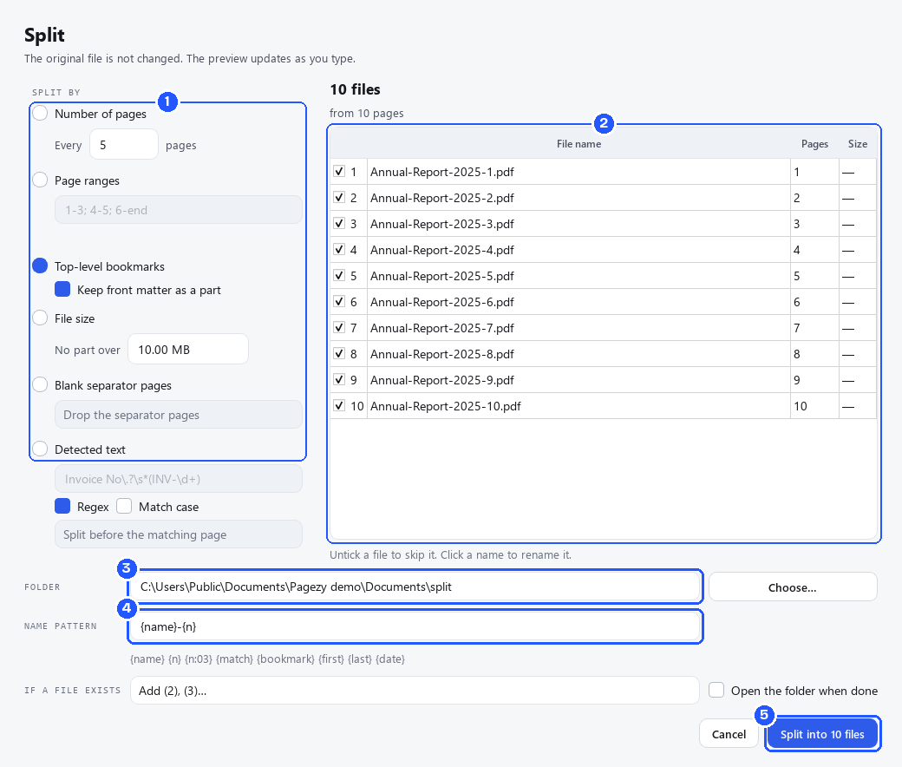

1. **Split by**:
   - **Number of pages**: every N pages.
   - **Page ranges**: for example `1-3; 4-5; 6-end`, with a semicolon between files.
   - **Top-level bookmarks**: one file per chapter. **Keep front matter as a part** keeps the pages before the first chapter.
   - **File size**: no part bigger than the size you set, for example 10 MB for email.
   - **Blank separator pages**: split wherever there is a blank page, for a stack of documents scanned in one go.
   - **Detected text**: split where a pattern appears, such as each new invoice number.
2. The preview: every file that will be made, with its pages and size. Untick a file to skip it, or click its name to rename it.
3. **Folder** to save the parts in.
4. **Name pattern**, for example `{name}-{n}`. Other codes: `{n:03}` (001, 002…), `{bookmark}`, `{match}`, `{first}`, `{last}` and `{date}`.
5. **Split into 10 files**. Pagezy then opens and checks every part, and confirms the pages add up.

To split in one click, right-click a page in the grid and choose **Split document after page N**.

## 23. Crop, page size and page labels

**Crop** (C) trims the margins of pages:

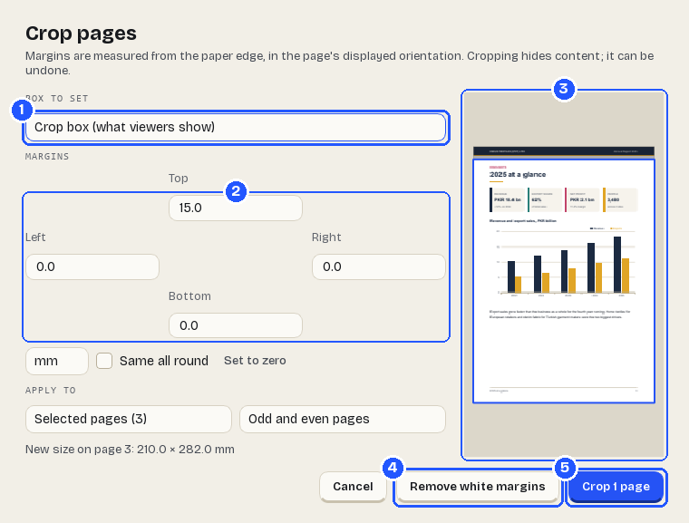

1. **Box to set**: normally the **Crop box (what viewers show)**. Print shops may ask for the **Trim box**, **Bleed box** or **Art box**; the **Media box** is the paper size itself.
2. The **Top**, **Left**, **Right** and **Bottom** margins, in mm, cm, inches or points. **Same all round** and **Set to zero** help.
3. The preview: the dimmed part will be hidden.
4. **Remove white margins** fits each page to its content automatically.
5. **Crop 1 page**. Under **Apply to**, choose all pages, the selected pages or a range, and odd or even pages.

Cropping hides the cut-off part; it stays in the file and can be undone.

**Page size** puts each page's content onto a new paper size, such as A4 or Letter. **Scale to fit** shrinks or enlarges the content to fit (with an optional margin), **Don't scale** keeps it as it is, and **Scale by percent** uses your own figure. **Keep each page's orientation** keeps landscape pages landscape.

**Page labels** are the page numbers viewers show, for example i–v for the front matter and 1, 2, 3 from the first chapter. The pages themselves don't change.

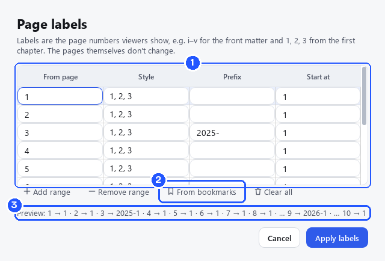

1. The ranges: **From page**, **Style** (1, 2, 3 · i, ii, iii · I, II, III · a, b, c · A, B, C · No number), **Prefix** (such as `A-`) and **Start at**. **Add range** and **Remove range** change the list.
2. **From bookmarks** makes one range per chapter, using the chapter numbers in the bookmark titles.
3. The preview shows which number each page will get.

After **Apply labels**, the labels show under the thumbnails and in the page box, and you can type them in page ranges in quotes, such as `"iv"`.

## 24. Make files smaller and clean them up

**Compress** makes a file smaller, mainly by shrinking pictures and scanned pages.

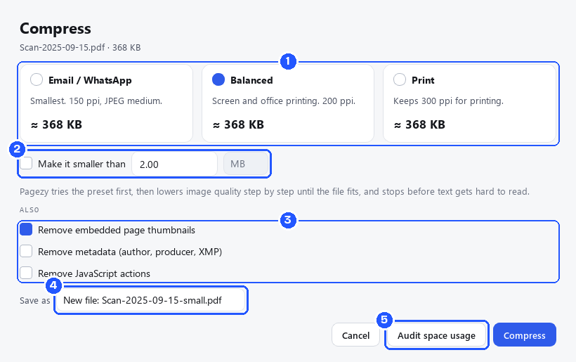

1. Choose a preset. Each shows the size you'll get:
   - **Lossless**: pages stay exactly the same. Pagezy only packs pictures and the file more tightly.
   - **Email / WhatsApp**: smallest, pictures at 150 ppi.
   - **Balanced**: for the screen and office printing, 200 ppi.
   - **Print**: keeps 300 ppi for printing.

   When the file has scanned pages, **Scanned pages** appears under the presets, with a line saying what Pagezy found. Pagezy picks the best choice for you:
   - **Keep them as pictures**: scans are shrunk like any other picture.
   - **Black and white, where they are only ink on paper**: plain text scans become crisp black and white, often a tenth of the size or less. Scans with colour or photos stay as they are.
   - **Sharp text over a lighter background (also colour scans)**: the text, stamps and signatures stay sharp and keep their colours, while the paper and any photos are stored at a lower resolution. Colour scans often shrink to a tenth of their size.

   Text you made searchable with **Recognize text** stays searchable whatever you choose.
2. **Make it smaller than** a size you set: Pagezy lowers picture quality step by step until the file fits, and stops before text gets hard to read.
3. **Also**: remove embedded page thumbnails, metadata (author, producer) and JavaScript actions.
4. **Save as**: a **New file** (`name-small.pdf`), or apply it to the open tab and save later. For a new file, tick **Fast web view** so its first page shows while the rest is still downloading from a website.
5. **Audit space usage** shows what takes up the space: pictures, fonts, page content, comments and so on, with the biggest objects.

After compressing, a report shows the size before and after, what was done, and checks that the pages, text, bookmarks, links and form fields all survived and that the pages still look right. Text and drawings stay sharp.

**Clean up** › **Remove blank pages…** finds empty pages and pages that went through the scanner twice:

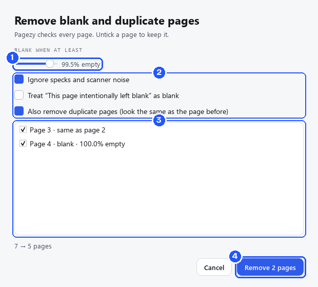

1. **Blank when at least** 99.5% empty (adjustable).
2. **Ignore specks and scanner noise**, **Treat "This page intentionally left blank" as blank**, and **Also remove duplicate pages (look the same as the page before)**.
3. The pages Pagezy found. Untick any you want to keep. A page with real text is never called blank.
4. **Remove 2 pages**.

**Clean up** › **Flatten forms and comments…** makes form fields and comments part of the page, so they can't be changed any more. Their text stays searchable. You can save the result as a new file or apply it to the open tab.

---

# Part 6. Forms and signatures

## 25. Fill in a form

When you open a PDF with fillable fields, Pagezy switches to **Forms** › **Fill** and tells you how many fields it has and how many are required.

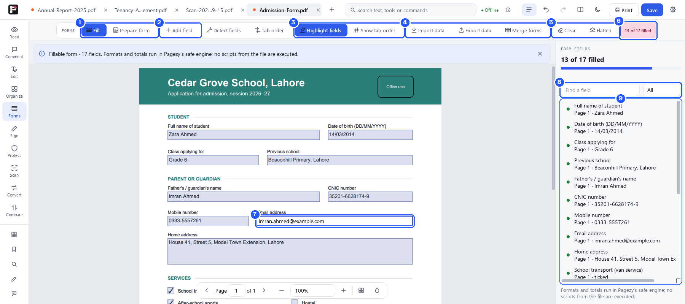

1. **Fill** and **Prepare form** (to make or change fields: [section 26](#26-make-a-form)).
2. **Add field**.
3. **Highlight fields** tints every field; **Show tab order** numbers them in the order Tab visits them.
4. **Import data**, **Export data** and **Merge forms** ([section 27](#27-form-data)).
5. **Clear** resets every field; **Flatten** makes the answers part of the page.
6. How many fields are filled.
7. Click a field and type. Check boxes and radio buttons tick at once.
8. **Find a field** by name, and filter the list to **Required**, **Empty** or **Errors**.
9. Every field and its value. Click one to fill it.

**Keys while filling**

| To | Press |
|---|---|
| Next / previous field | Tab / Shift+Tab |
| Tick a box, or open a list | Space |
| Finish a field | Enter (in a multi-line field, Enter adds a line) |
| Leave a field without keeping what you typed | Esc |
| Go to the next empty required field | Ctrl+Enter |
| Next / previous field with a problem | F8 / Shift+F8 |
| Open a calendar in a date field | Alt+Down arrow |

**Any language.** Answers in Urdu, Arabic, Hindi and other languages are drawn with joined letters and the font is put in the file, so the filled form looks right in every PDF app and when printed. Right-to-left answers start at the right of the field.

**Totals and formats work for you.** Pagezy formats numbers, dates and phone numbers as the form expects, and adds up totals as you type. It never runs scripts from the PDF: it does the standard form calculations itself, safely.

**Mistakes are marked, not blocked.** A value that doesn't fit (for example a date that doesn't exist) is kept but marked red, with a message such as "Enter a date like dd/mm/yyyy" in the bottom-left corner of the page area.

**Signed forms.** If the form is already signed, what you fill in is saved after the signed part, so the signatures stay valid when the signer allowed form filling. If a change wouldn't be allowed, **Save** asks first.

**XFA forms.** Some forms are built with Adobe's XFA technology. Pagezy fills the simpler (static) kind normally. The dynamic kind only shows its placeholder pages in Pagezy, but you can still import and export its data.

## 26. Make a form

Click **Prepare form** to add fields to any PDF, or to change existing ones.

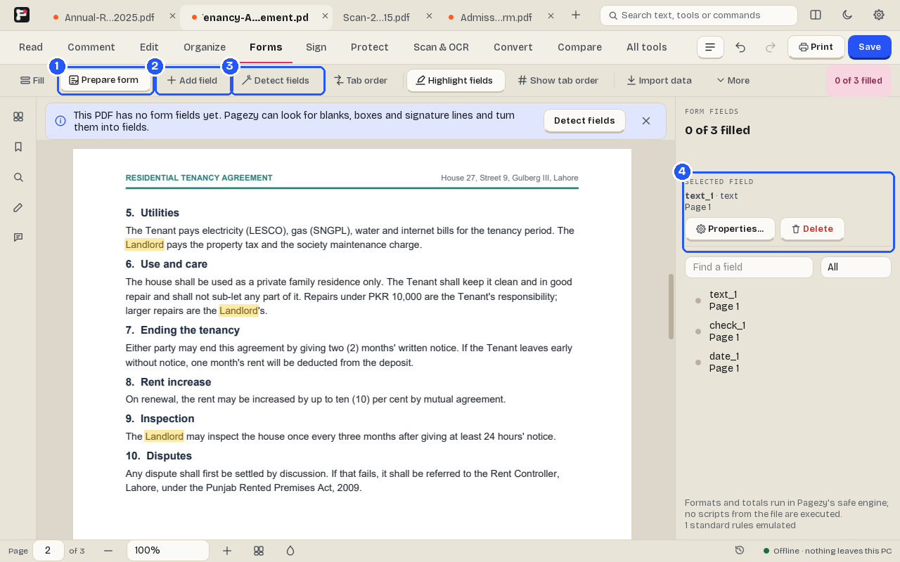

1. **Prepare form**.
2. **Add field**: **Text field**, **Check box**, **Radio button**, **List box**, **Dropdown**, **Button**, **Date field** or **Signature field**. Then click the page for a standard-size field, or drag to draw its size.
3. **Detect fields** finds the blanks for you: underlines, boxes, rows of character boxes, check boxes, date lines and signature lines. It suggests a name for each from the label beside it. Review them, untick any you don't want, and click **Keep**.
4. The selected field, with **Properties…** and **Delete**.

**Change a field.** Click it to select it, drag to move it, and drag the corner handle to resize it. The arrow keys nudge it. Double-click it (or press Enter) to open its properties.

1. The tabs:
   - **General**: **Name**, **Tooltip**, **Required** and **Read only**.
   - **Options**: multi-line text, a character limit, a default value, and the items of a list or dropdown (one per line).
   - **Format**, **Validate** and **Calculate**, for text, date and dropdown fields.
2. **Format**: **Number** (decimal places, separators, negative numbers in red or brackets, a currency symbol such as PKR), **Percentage**, **Date**, **Special** (zip code, phone number, social security number) or **Arbitrary mask** (for example `99999-9999999-9` for a CNIC).
3. The preview shows how sample values will look.

**Validate** sets the lowest and highest allowed value. **Calculate** makes the field a **Sum**, **Product**, **Average**, **Minimum** or **Maximum** of other fields.

**Tab order** sets the order Tab moves through the fields on a page: drag the names, or choose **Order by rows** or **Order by columns**.

Each radio button you add forms its own group; Pagezy can't join separately added radio buttons into one group yet.

## 27. Form data

- **Import data** fills the form from an FDF, XFDF, XML, CSV, text or JSON file. Before anything changes, Pagezy shows how each column matches a field and converts values to the field's format. Tick **Only fill empty fields** to keep what is already filled.
- **Export data** saves the answers as XFDF, FDF, XML, JSON, CSV or tab-separated text.
- **Merge forms** collects many returned forms into one spreadsheet (Excel or CSV), one row per form. It works without opening anything: choose the returned files and where to save the sheet.
- **Clear** resets every field to its default value (Pagezy asks first; you can undo).
- **Flatten** makes the answers part of the page so nobody can change them. Choose **Into a copy** (`name-flat.pdf`) or **In this document**.

Pagezy never runs scripts from a PDF. **Show scripts** in the panel lists any the form contains, so you can see what they were meant to do.

## 28. Fill and sign any PDF

**Fill & sign** lets you type, tick and sign anywhere on a PDF, even one without form fields. Switch to **Sign** in the mode rail.

1. **Text** (T), **Check** (K), **Cross** (X), **Dot** (O), **Line** (L), **Date** (D) and **Initials** (I).
2. **Signature** (S) places your signature; its arrow lists your saved signatures.
3. **Autofill** (A) fills blanks from your profile.
4. **Certificate sign**, **Validate all** and **Digital IDs** ([section 29](#29-certificate-signatures-and-digital-ids)).
5. **Request signatures** ([section 30](#30-ask-others-to-sign)).
6. **Ink** (blue, black or red), **Text size** and **Date format** for what you add.
7. **Items on this document**: everything you placed. Select one to resize it with **−** and **+**, or **Remove** it. **Flatten items into the page** fixes them in place.
8. Your saved signature.

**Type anywhere:** click **Text**, then click the page and type. Near a line or a row of underscores, the text sits neatly on the line (hold **Alt** to place it freely). In a row of character boxes, such as a CNIC, each character goes in its own box. If you click a real form field, Pagezy fills the field instead.

**Ticks, crosses, dots and dates:** click to place. In a small box, the mark fills the box. **Line** strikes through words: drag across them. **Date** places today's date.

**Move or remove items:** with **Select** (V), click an item, drag it, or drag its corner to resize it. Press **Delete** to remove it. Placed text can't be retyped; remove it and add it again.

### Your signature

1. **Signature** or **Initials**.
2. **Ink** colour.
3. Three ways to make it:
   - **Draw** with your mouse, pen or finger.
   - **Type** your name and pick a style.
   - **Image**: choose a photo or scan of your signature on white paper. Pagezy removes the paper and keeps the ink.
4. **Save on this PC for next time (encrypted)**.
5. **Save and place**, then click where your signature should go. It sits on a nearby signature line if there is one.

**Manage saved signatures…** lets you choose your default signature or delete one.

> A picture of a signature is not a certificate signature. To prove who signed and that nothing changed afterwards, use a certificate signature ([section 29](#29-certificate-signatures-and-digital-ids)).

### Autofill

Fill in your profile once (**Signature** › **Edit autofill profile…**): name, father's or husband's name, CNIC, passport number, date of birth, address, phone, email, company and job title. It is stored encrypted on your PC.

Then click **Autofill** on any form. Pagezy reads the labels on the page, in English and some Urdu, and shows what it would fill where. Tick the entries you want and click **Place**. Undo removes them all at once.

## 29. Certificate signatures and digital IDs

A **certificate signature** proves who signed a PDF and that nothing changed after signing. It needs a **digital ID**: your name and a secret key. Pagezy can use three kinds:

- **A digital ID file** (.pfx or .p12) protected by a password. Pagezy can make one for you.
- **A certificate in Windows**: one your company or a certificate authority installed on your PC, including smart cards Windows already knows. Windows keeps the key and asks for the PIN itself when it needs one. (Windows only.)
- **A USB token or smart card**, through the PKCS#11 library that came with it. Pagezy asks for the token's PIN each time and never saves it.

### Your digital ID

Open **Digital IDs** (Sign › **Digital IDs**, or Home › Forms & sign). It works with no file open.

1. The pages: **My IDs**, **Windows certificates** (Windows only), **USB tokens**, **Trusted certificates** and **Trust lists**.
2. Your IDs. The star marks your default one.
3. The selected ID's details: name, key, valid dates and fingerprint.
4. **Import .pfx / .p12…** brings in an ID you already have. **Export certificate…** saves the public part of your ID, which you can give to people so their PDF apps trust your signature (and so they can encrypt files for you). **Make default** and **Remove** are next to it.
5. **Create ID…** makes a new self-signed ID: type your name (and optionally organisation, email and country), choose how many years it lasts, choose **Use for** (**Signing**, or **Signing and encryption** if people should be able to encrypt files for you), and set a password of at least 8 characters. There is no way to recover a forgotten password.

**Windows certificates** lists the personal certificates in Windows that have a private key. Pagezy only reads this list; it never changes anything in Windows. **Make default** picks one for signing, and **Export certificate…** saves its public part.

**USB tokens**: plug in the token, click **Add from token…**, choose the token's PKCS#11 library (a .dll file from the token's software, for example in `C:\Windows\System32`) and click **Find certificates**. Pick the certificate and click **Add certificate**. If the token only shows its certificates after the PIN, Pagezy asks for it for that one read. Pagezy remembers where the library is and which certificate to use, never the PIN.

Under **Trusted certificates**, **Import certificates…** adds the certificates of people and organisations whose signatures you check. Your own IDs are always trusted. **Trust lists** is described under [Which signatures are trusted](#which-signatures-are-trusted).

### Sign

Click **Certificate sign** (Ctrl+Shift+G). Then drag a box where the signature should appear, click an empty signature field, or press **Enter** for an invisible signature.

1. **Digital ID**: your ID files, Windows certificates you used before, your USB tokens, and **Choose a certificate from Windows…** to pick another one from Windows.
2. **Password** of an ID file, or the **PIN** of a USB token. A Windows certificate needs neither here: Windows asks for the PIN itself if it needs one.
3. **Type**: **Approve (others can still sign)**, or **Certify (first signature, sets what may change)**. A certification sets **Allowed changes**: none, filling forms and signing, or that plus comments. **Lock the document after signing** stops further changes.
4. **Reason**, **Location** and **Contact**.
5. **Show**: what the visible signature says (name, date, reason, location, labels).
6. **Graphic**: none, your saved signature, or a picture or logo.
7. **Timestamp server** (optional) and **Add long-term validation**. Leave both off to stay offline.
8. **Sign and save copy** (Ctrl+Enter). The signed file is saved beside the original as `name-signed.pdf` and opens in a new tab.

**Long-term validation** stores your certificate's revocation status (whether it was cancelled) inside the file, so the signature can still be checked years later, after your certificate has expired. With a timestamp server it also seals the file with a final timestamp. To get that status Pagezy has to ask the servers named in your certificate, so before anything is sent it shows you their names and waits for **Go online and sign**. Only certificate status and timestamps are requested, never your document, and every request appears in **Settings › Privacy & network**. A self-signed ID has nothing to look up, so it stays offline.

**Encrypted files** can be signed too. The signature is added inside the encryption, and the signed copy keeps the same password or the same people who can open it ([section 31](#31-passwords-and-permissions)). If you want a file both encrypted and signed, encrypt it first and then sign: encrypting a signed file writes a new file, and its signatures stop validating.

### Check signatures

Pagezy checks signatures when you open a signed file, all on your PC. You can check again with **Validate all** (**Ctrl+Shift+V**).

1. The result bar: green for **Valid, not changed since signing**, amber when the document is intact but you don't trust the signer yet, and red when the document changed after signing. **Signature details** opens the full report.
2. The **Signatures** panel lists each signature with its state, and for a trusted one, what made it trusted. Double-click one for details: who signed, when, why, which certificate, **Trusted through**, **Long-term validation**, and every check. **Open signed version** opens the file exactly as it was signed. **Trust this certificate…** adds the signer to your trusted certificates (check its fingerprint with the signer first).
3. **Validate all**.

| State | Means |
|---|---|
| **Valid** (green) | Not changed since signing, and the signer's certificate leads to one you trust. |
| **Valid, identity unknown** (amber) | Not changed, but none of your trust sources vouches for the signer. |
| **Invalid** (red) | Changed after signing in a way that wasn't allowed. |
| **Unknown** (grey) | Couldn't be fully checked, for example an encrypted file opened without its password. |

Pagezy never goes online to check revocation. When a signature has long-term validation, Pagezy checks it with the information stored in the file and says **Not revoked when it was signed**.

### Which signatures are trusted

A signature shows as **Valid** only when its certificate leads to one you trust. Signature details always say which source it was:

- **your trusted certificates**: the ones you imported or trusted from a signature;
- **your own digital ID**;
- **Windows trusted roots**: the certificate authorities Windows trusts (the same ones your browser uses for websites). This is off until you turn on **Trust certificates Windows trusts** in **Settings › Forms & signatures**. Windows fetches some of these only when it first needs one, so a rarely used authority may be missing;
- **a trust list** you imported: in **Digital IDs › Trust lists**, click **Import trust list…** and choose a list you downloaded yourself, such as an EU trusted list (.xml) or a certificate bundle (.pem, .p7b, .p7c, .cer) that a certificate authority or your company publishes. From an EU trusted list Pagezy takes only the certificate authorities whose service is current. Pagezy never downloads lists by itself. **Remove** takes a list away again.

## 30. Ask others to sign

Pagezy has no server, so it can't email signers or chase them. Instead it prepares a signing packet you send yourself, and checks every copy that comes back.

1. The signers: **Name**, **Email** and **Role** (**Signer**, **Witness** or **Approver**).
2. **Add signer** and **Remove signer**.
3. **In order** or **Any order**.
4. **Create signing packet**.

The packet is a copy of your PDF with an empty signature field for each person (on their "Signature of …" line when Pagezy finds it, otherwise on the last page), plus a request page with an ID and the original's fingerprint. A **How to sign.txt** file is saved beside it. Send both with your own email or file sharing.

When a signed copy comes back, choose **Request signatures** › **Check a returned copy…**. Pagezy tells you who has signed, whether the signatures are valid, whether the document was changed, and who you're still waiting for.

---

# Part 7. Protect

Switch to **Protect** in the mode rail.

1. **Password**, **People** (encrypt for people), **Policies** and **Remove security** ([section 31](#31-passwords-and-permissions)).
2. **Mark text** (R), **Mark area**, **Redact pages** and **Find & redact** (**Ctrl+Shift+R**) ([section 32](#32-redact)).
3. **Apply** the redactions.
4. **Sanitize**, **Label** and **Active content** ([sections 33](#33-remove-hidden-information) and [34](#34-scripts-risky-actions-and-classification-labels)).
5. **Document security**: whether the file has a password and what it allows.
6. The redaction marks, page by page. Click one to see it; **×** or Delete removes it. **Remove all** clears them.
7. **Show the redacted look** previews the marks as they'll look when applied.
8. **Redaction properties** for new marks: **Fill colour** (black, white, grey, red or your own) and **Overlay text** such as "REDACTED", optionally repeated to fill the box.

## 31. Passwords and permissions

Click **Password** (or Home › **Protect with password**).

1. **Require a password to open**.
2. **Open password**. **Show** reveals it and **Generate** makes a strong four-word passphrase for you.
3. How strong the password is. Type it again under **Confirm open password**.
4. **Restrict printing and editing**, with its own **Permissions password** (which must differ from the open password).
5. **Printing allowed**: none, low resolution (150 dpi) or high resolution.
6. **Changes allowed**: none, inserting and rotating pages, filling forms and signing, comments as well, or anything except extracting pages.
7. **Allow copying of text, images and other content** and **Allow text access for screen readers**.
8. **Encryption**: **AES-256** (recommended; opens in Acrobat, Chrome, Edge, Firefox and Preview) or AES-128 for older readers. You can leave the metadata unencrypted so desktop search can still find the title.
9. **Apply security**. The file is protected when you save, and Ctrl+Z undoes it until then.

> A lost open password can't be recovered by Pagezy or anyone else. Keep it in a password manager. And remember that printing and copying restrictions are honoured by most apps, but not all: to stop text from leaving, redact it.

**Save as policy…** saves these settings (never the passwords) under a name. Next time, pick it from **Policies** and just type the passwords.

**Remove security** takes the password and restrictions off a file you can open. If the author set a permissions password, Pagezy asks for it. Save to write the file without protection.

### Encrypt for people

Instead of a password you have to share, you can encrypt a file so that only certain people can open it, each with their own digital ID. Click **People** (or Home › **Encrypt for people**).

1. **People who can open it**: click **Add certificate…** and choose each person's public certificate (.cer, .pem or .p7c; ask them to export it from their PDF app or from Pagezy's Digital IDs). **Add my ID** adds one of your own IDs, so you can open the copy too. **Remove** takes someone off.
2. **They may**: **Print**, **Copy text and images**, and **Change, fill in and comment**.
3. **Encrypt and save copy** (Ctrl+Enter) saves `name-encrypted.pdf` beside the original. The original isn't changed.

A certificate made only for signing can't be used to encrypt; Pagezy says so next to it. IDs you create with **Use for: Signing and encryption** work for both.

**Opening a file encrypted for you.** Open it as usual. Pagezy asks which digital ID to use (the ones that can open it are marked **can open this file**) and the ID's password; for a Windows certificate, Windows asks for the PIN if needed. The file opens in a tab and stays encrypted: Pagezy never writes the opened content to disk, and **Save** encrypts it again for the same people. If Pagezy doesn't have everyone's certificate, a bar says so; add them in **People** before you save, or they lose access.

## 32. Redact

Redacting removes text, pictures and whole pages for good: the content is really deleted from the file, not just covered. It happens in two steps: first you **mark**, then you **apply**.

**Mark by hand:**
- **Mark text** (R): drag across words, or double-click a word.
- **Mark area**: drag a box over anything, including pictures and drawings.
- **Redact pages**: type pages such as `5, 2-4, odd, even, last`.

Marks show as red outlines. Until you apply them, nothing is removed; they are standard redaction marks, so Acrobat can apply them too.

**Find & redact** (Ctrl+Shift+R) finds the sensitive details for you:

1. What to look for:
   - **Words**: a name or phrase.
   - **List**: many words at once, typed or imported from a text or CSV file.
   - **Patterns**: email addresses, CNIC and other national IDs, US social security numbers, IBANs, card numbers, passport numbers, phone numbers, dates and Pakistan NTNs. IBANs and card numbers are checked properly, so random digits aren't flagged. Urdu and Arabic digits are understood.
   - **Regex**: your own pattern.
2. **Whole words** and **Match case**.
3. **Search**.
4. Every hit, grouped, with the words around it. Untick any to leave alone. **J** and **K** step through them on the page.
5. How many are ticked.
6. **Mark 6 ticked hits**.

Only real text is searched; make scans searchable first ([section 35](#35-make-a-scan-searchable)).

**Apply** removes everything under the marks:

1. **Also remove hidden information (metadata, scripts, attachments, comments)**.
2. **Open the result as a new document** (`name-redacted.pdf`), so your original stays as it was.
3. **Apply 6 marks**.

Pagezy then reopens the result and checks that nothing is left: no text, no letter shapes, no picture pixels, and no copies in the metadata or bookmarks. The report shows each check passing, and **Export report** saves it (without the removed text). If a check can't pass, Pagezy changes nothing and offers to redact that page as an image instead. Save the result to keep it.

## 33. Remove hidden information

PDFs often carry more than you see: the author's name, older versions of the text, comments, attachments, hidden layers. **Sanitize** finds and removes them.

1. **Preset**: **Sharing outside** (the default), **Everything (sanitize)** or **Metadata only**.
2. What Pagezy found, by group, with a count: document metadata, XMP metadata, attached files, comments and markups, form fields, hidden text, hidden layers, bookmarks, deleted and earlier content, links and JavaScript, content outside the page, thumbnails, and digital signatures. Tick what to remove.
3. **Keep accessibility tags** (and, under Hidden text, keep the searchable text of scanned pages).
4. **Open the result as a new document** (`name-sanitized.pdf`).
5. **Remove 20 items**.

The file is rewritten from scratch, then reopened and checked. A report shows the size before and after and each check.

## 34. Scripts, risky actions and classification labels

**Active content.** Pagezy never runs scripts from a PDF, and always blocks actions that would start a program. When a file contains them, a yellow bar says so. Click **Review** (or **Active content**) to see each one, what it is, where it is, and its status (**Not run**, **Blocked** or **Asks first**). **Remove all active content** takes them out.

**Classification label** marks a file **Public**, **Internal**, **Confidential** or **Highly confidential**.

1. The labels. If the file contains CNICs, IBANs, card or passport numbers, Pagezy suggests one; you decide.
2. What the label does: Internal adds a footer; Confidential adds a header and footer; Highly confidential adds a diagonal watermark too. Every label is also written into the file's properties.
3. **Apply Confidential**.

Lowering a label (for example Confidential to Internal) asks for a reason, which is kept in the file's label history.

---

# Part 8. Scan and OCR

**OCR** (optical character recognition) reads the words in a picture of a page, so you can search, select, copy and read aloud a scanned document. Everything runs on your PC; nothing is uploaded.

## 35. Make a scan searchable

When you open a scanned PDF, Pagezy notices:

1. A blue bar says the page is a scan, and that find, copy and read aloud can't see its words yet.
2. **Make searchable** (R).
3. **Not now** hides the bar. The **×** hides it for this file for good.

You can also use Home › **OCR scans**, **Recognize text** in the **Scan & OCR** mode, or right-click a page and choose **Recognize text on this page**.

1. **Engine**:
   - **Neural · RapidOCR** is built in. It is best on phone photos, faxes and poor scans. It reads English, other Latin-script languages, Chinese and Japanese, and with a free script pack also Urdu, Arabic, Persian, Pashto, Hindi, Marathi, Nepali, Russian, Ukrainian and more.
   - **Tesseract 5** reads more than 100 languages and is very exact on clean print. It needs Tesseract installed (free); then choose your languages.
2. **Languages**. For the built-in engine, pick the **Script** the pages are written in; a script appears here once its pack is downloaded. For Tesseract, tick the languages on the pages, most common first. **Manage language packs…** downloads more.
3. **Pages**: **All pages**, **Current page** or a **Range**.
4. **Pages that already have text**: **Skip them**, or **Replace old OCR text** to read them again.
5. **Options**: **Straighten and auto-rotate pages** (for reading; the scan itself isn't changed), **Clean the background first** for faint or yellowed scans, and **Flag words below 80 %** confidence for you to check.
6. **Recognize 1 page**.

Recognition runs in the background; you can keep working. Pagezy reads several pages at once, so long scans finish sooner, and a page scanned sideways or upside down is turned the right way up first. The page looks exactly the same afterwards: the words are added as invisible text behind the picture. Urdu, Arabic and Persian come out in the order you read them, so search and copy work as expected. The whole run is one step you can undo. Save to keep it.

> To change the words on a scan, not just search them, use Edit ([section 19](#19-edit-the-words-on-a-scanned-page)).

**Language packs**:

1. **Filter languages**: type a language, such as Urdu, to find the pack that reads it.
2. **Built-in engine** script packs: Arabic script (Urdu, Arabic, Persian, Pashto, Sindhi), Devanagari (Hindi, Marathi, Nepali), Cyrillic (Russian, Ukrainian, Bulgarian and more) and an extra Latin pack for accented languages. Each shows what it reads, its size (about 8 MB) and its licence. Click **Download**; Pagezy shows exactly what it will download and from where before it starts, and checks the file before using it. **Remove** deletes one.
3. **Tesseract** languages, with their size and whether they're installed. **Download** and **Remove** work the same way.
4. Where the Tesseract packs are kept.

Language packs are the only thing these tools ever download, and only when you ask.

## 36. Check and correct recognized text

The **Scan & OCR** mode collects everything about scanned pages:

1. **Recognize text** (R).
2. **Correct text** (C) jumps to the words to check.
3. **Enhance** (Shift+E): clean up scans ([section 37](#37-clean-up-scans)).
4. **From scanner** (Shift+S), **Phone as scanner** (Shift+P) and **Images to PDF** (Shift+I).
5. **Show recognized text** (T) draws the recognized words on the page, so you can see what was read. Next to it, **Languages** opens the language packs.
6. A summary: how many pages and words were recognized, by which engine. **Export .txt** saves all the text.
7. **Flag words below**: raise it to check more words, lower it for fewer.
8. The word to check, with the scan beside it. Correct it if needed.
9. **Accept** (Enter) keeps it and moves on, **Skip** (Tab) moves on, and **Not text** (Delete) removes something that isn't a word, such as a smudge.
10. Every word to check. Click one to jump to it.

Pagezy also spots numbers where a letter was read by mistake (O for 0, l for 1, S for 5) and suggests the fix; **Fix … letter-for-digit slips in numbers** fixes them at once. **Ctrl+Enter** accepts every remaining word on the page. Corrections change only the hidden text; the scan picture stays as it was.

To remove recognized text from a page, right-click it and choose **Remove recognized text from this page**.

## 37. Clean up scans

**Enhance** straightens, cleans and crops scanned pages and phone photos of pages.

1. The preview: **Before** on the left, **After** on the right. Drag the line to compare.
2. Two tabs: **Clean up**, and **Crop and flatten** for photos of a page: Pagezy finds the page's edges, and you can drag the four corners.
3. **Straighten**, with the angle found.
4. **Remove background**: **Off**, **Low**, **Medium** or **High**. It whitens grey or yellowed paper and keeps the ink.
5. **Colour**: **Keep colour**, **Grayscale** or **Black and white**.
6. **Despeckle** (removes small specks), **Sharpen text**, and the black-and-white threshold.
7. **Apply to**: **This page**, **All scanned pages** or chosen pages.
8. **Apply**. One step you can undo.

Enhancing replaces the page picture, so pages that were already recognized need **Recognize text** again; Pagezy offers it. Enhance first, then recognize.

## 38. Scan with your phone or a scanner

### Your phone as a scanner

Your phone's camera can send pages straight to Pagezy over your own Wi-Fi. No app and no account are needed.

1. **Network**: the Wi-Fi network your phone is on.
2. **Encrypted connection (recommended)**.
3. **Start session**. Windows may ask to let Pagezy through the firewall; allow it on private networks.

Pagezy then shows a QR code and a one-time code:

1. Join the same Wi-Fi on your phone.
2. Point the phone's camera at the QR code and open the link. Your phone will warn that the connection is not private; that's expected. Check that the fingerprint matches the one Pagezy shows, then continue.
3. Type the one-time code if asked.
4. Tap **Take a photo of a page** for each page. Each photo appears in Pagezy, cropped and straightened.
5. Click **Done · add pages**. The pages become a new PDF, or are added to the open file, and are made searchable if you ticked that.

The session ends when you close the window, or after 15 minutes without photos.

### From a scanner

**From scanner** (Shift+S) works with any scanner that Windows shows in Settings › Printers & scanners (on Linux, through SANE). Choose the **Scanner**, the **Resolution** (300 dpi is best for text), **Colour**, **Grayscale** or **Black and white**, and whether to straighten each page and make it searchable. Put a page on the glass, click **Scan page**, and repeat; then click **Done**. If no scanner is found, **Scan with phone instead** is offered.

## 39. Turn images into a PDF

**Images to PDF** (Home, or Shift+I in Scan & OCR) combines pictures into one PDF. You can also drop several pictures on the window.

1. How many pages you'll get. **Add images…** adds more (JPG, PNG, TIFF, BMP, GIF, WebP and HEIC).
2. The pages in order. Drag to reorder, or use **Rotate left**, **Rotate right**, **Move up**, **Move down**, **Sort by name** and **Remove**.
3. **Page size** (fit to the image, A4, Letter, Legal, A3, A5), **Orientation**, **Margins**, **Placement** and **Compression** (keep the originals, or a smaller balanced copy).
4. **Crop and straighten photos of pages**, and **Make searchable afterwards**.
5. **Create PDF**.

JPEG photos go in untouched, without losing quality. Camera details and GPS location are removed from photos.

---

# Part 9. Convert, create and print

1. **Export** to another format.
2. **Extract table**.
3. **Create PDF**.
4. **Print**.
5. **PDF/A**: save an archive copy, a print-ready PDF/X copy or an e-invoice.
6. **Preflight**: check before printing.
7. **Accessibility check**.

## 40. Export to Word, Excel and more

Choose a format from **Export**, press **Ctrl+E**, or use Home › **PDF to Word**, **PDF to Excel** or **Export images**.

1. **Preview**: the page as it is in the PDF, next to a drawing of what the export makes of it, with its real words, headings, lists, tables and pictures. The arrows move to the other pages; **Side by side** or **Word only** changes the view.
2. The format: **Word**, **Excel**, **PowerPoint**, **Web page**, **Text** and **Images**. Under Text, choose **Plain text**, **Markdown** or **JSON**; under Images, **PNG**, **JPEG** or **TIFF**.
3. **Layout**, for Word, PowerPoint and web pages:
   - **Easy to edit**: paragraphs that reflow, with real headings, lists and tables. Best for changing the words. In PowerPoint, plain slides where the text, tables and pictures are separate objects.
   - **Looks the same**: every line and picture stays where it was on the page. Best for printing or forms. In PowerPoint, the page becomes the slide background with editable text on top.
4. **Pagezy found**: columns, tables, headings, a running header and footer (and where it goes, for example into the Word header) and scanned pages. A scanned page has no text of its own: leave **Recognize text on scanned pages** ticked and Pagezy reads its words while it exports, so a scanned table becomes a real Excel table. Without it, recognize the pages first ([section 35](#35-make-a-scan-searchable)).
5. **Pages**: all, the current page, or **Choose pages…** (for example `1-3, 7`).
6. **Smart layout** finds tables, titles, pictures, headers and footers more reliably, including tables without lines and tables whose cells wrap onto several lines. It needs two layout models, a one-time download of about 131 MB that only happens when you click **Download…**; Pagezy checks every file before it uses it, and nothing from your documents is sent. It adds about a second per page.
7. **More options** for the chosen format. For Word: **Pictures and drawings**, **Tables as Word tables** and **Keep PDF page breaks**. For Excel: one sheet per table, per page, or for the whole document, and **Detect numbers**. For images: resolution, colour, JPEG quality and **All pages in one TIFF file**.
8. **Open when done**, then **Export to Word** (the button names the format). Choose where to save; a green bar then offers **Open** and **Show in folder**.

In every format, columns are read in order, a hyphen at the end of a line is removed when it splits one word (and kept in words such as "well-known"), lists keep their indents, and charts and diagrams drawn in the PDF come out as pictures.

**Batch export…** converts many PDFs to the same format, and the same layout, in one go. The files you add are never changed, and existing files are never overwritten.

## 41. Pull a table out of a PDF

Click **Extract table** and drag a box around a table on the page.

1. **Detection**: **Automatic**, **Ruling lines** (tables with drawn lines) or **Text alignment** (tables without lines).
2. **First row is the header** and **Detect numbers**.
3. What was found, for example "10 rows × 4 columns".
4. The table as it will be saved.
5. **Save as Excel…**, or **Copy** (paste straight into Excel or Word), **Save CSV…** or **Save Markdown…**.

The tool stays on, so you can box the next table.

## 42. Create a PDF

Click **Create PDF** (or Home › **Create PDF**):

1. Where the pages come from:
   - **Blank pages**: plain, ruled, grid or dot paper, in A3, A4, A5, Letter or Legal.
   - **From the clipboard** (Ctrl+Alt+V): a copied picture or text becomes a page.
   - **Screenshot**: the whole screen, or an area you drag. Pagezy hides itself while it captures.
   - **From a file**: saved web pages (.html), Markdown (.md) and text files are converted on your PC. Word, Excel and PowerPoint files are converted by an office program on your PC (see below).
2. **Continue**.

Every new PDF opens in a tab; save it to keep it.

**Word, Excel and PowerPoint files.** Before converting, Pagezy shows which program will make the PDF under **Made by**, with a line on what to expect. When there's a choice, pick another one from the list; Pagezy remembers it for next time. Then click **Create PDF**.

- **Microsoft Word**, **Excel** or **PowerPoint**, if Microsoft Office is installed: the pages look exactly as they do in Office. Office stays hidden the whole time, opens a copy of your file without running its macros, and closes again when it's done; Office windows you already have open are left alone.
- **LibreOffice** (free), if it's installed: the pages usually look the same, though complex layouts can shift a little.
- **Simple layout (built in)**, for Word files (.docx) when neither is installed: keeps the text, headings, lists, tables and pictures, but not the page design (fonts, columns, headers and footers).

If no program can open the file (an Excel or PowerPoint file without Office or LibreOffice), Pagezy explains how to install LibreOffice, or lets you point to it if it's installed somewhere unusual. The conversion runs in the background (cancel it from **Background tasks**, the clock button at the top); one that takes more than two minutes is stopped.

## 43. Print

Press **Ctrl+P** (or click **Print**).

1. **Printer**, or **Save as PDF (Pagezy)**.
2. **Copies** and **Collate**.
3. **Paper** and orientation.
4. **Pages**: all, the current page, the selection, or a range such as `1-3, 7, odd, last`. You can also print odd or even pages only, and in reverse order.
5. **Layout**:
   - **Normal**: fit to the page, actual size, shrink oversized pages, or your own scale.
   - **Multiple**: 2, 4, 6, 9 or 16 pages per sheet.
   - **Booklet**: see below.
   - **Poster**: one page printed big across several sheets, with overlap, cut marks and tile labels.
6. The options for that layout, here **Pages per sheet**.
7. **Live preview** of each sheet. The dashed line is the area your printer can print on.
8. How many sheets will print.
9. **Print** (Ctrl+Enter).

Under **Output** you can also print without comments, in grayscale, as an image, and on both sides.

On Windows, Pagezy sends each page to the printer as real text and lines, so small print stays sharp at whatever resolution your printer has, and big jobs stay small. **Print as image** sends pictures of the pages instead; try it if a printer gets a page wrong. On a Mac or Linux, and with **Save as PDF (Pagezy)**, pages are always sent as pictures, at your printer's resolution up to 600 dpi.

Comments that their author marked as not for printing never print, just as in other PDF readers. Untick **Print comments and form fields** to leave out every comment and form field.

**Output preview…** shows how a page splits into the four printing inks:

- Untick **Cyan**, **Magenta**, **Yellow** or **Black** to see what the other inks print on their own.
- **Ink coverage on this page**: the average and highest amount of each ink, and the highest total. Tick **Highlight total ink above** to colour the areas that use more ink than your print shop allows (often 300%).
- **Colours converted with**: the file's own press profile when it has one, a simple estimate, or a CMYK profile installed on your PC.
- **Overprint**: pages where objects print on top of the colours beneath instead of replacing them. White objects set to overprint are marked in red, because they disappear on a printing press.

The output preview is an estimate made from screen colours. For a job that has to be exact, ask the print shop for a proof.

1. **Sides**: both sides, or front and back separately for a printer that can't print double-sided.
2. **Binding**: left, or **Right binding (Urdu, Arabic)**.
3. The preview shows each side of each sheet. Print on both sides, flipping on the short edge, then fold.

Printing runs in the background and never changes the document.

## 44. Check a file before printing or archiving

**Preflight** (Ctrl+Shift+X) checks a file before it goes to a print shop or out by email:

1. **Profile**: **Digital printing**, **PDF/X-4 press** (for offset printing), **Web and email** or **PDF/A** (the PDF/A part the file claims, or PDF/A-2b).
2. **Analyse** runs the check again. **Save report…** saves the results.
3. The count of errors, warnings and information.
4. The findings, such as fonts that aren't embedded, pictures below 150 ppi (300 ppi for PDF/X-4 press), RGB colour, transparency, white objects set to overprint, mixed page sizes and heavy ink. Click one to see where it is.

Preflight only reports; it doesn't change the file.

### Save as PDF/A, PDF/X or an e-invoice

Click **PDF/A** (or Home › **PDF/A**) to save a copy that follows a standard.

1. **Standard**: the kind of copy you want:
   - **PDF/A-2b · archiving**: keeps the document looking the same for decades. Fonts are embedded, colours are defined and scripts are removed. Choose this when you aren't sure.
   - **PDF/A-2u · archiving, searchable**: like PDF/A-2b, and every letter can be searched and copied.
   - **PDF/A-1b · oldest archive format**: only for archives that ask for PDF/A-1. It can't hold transparency, layers or attached files.
   - **PDF/A-3b · archiving with attachments**: like PDF/A-2b, and keeps attached files. Click **Add files…** to attach more, such as the spreadsheet behind a report, and say how each one relates to the document (its source, its data, the same content in another format, or extra material).
   - **PDF/X-4 · print**: a file a print shop can print without surprises. Choose the **Press profile** the print shop uses, such as Coated FOGRA39; Pagezy lists the profiles installed on your PC, or click **Choose a profile file…** for the one the print shop sent you. Pagezy embeds fonts, sets the trim box, marks RGB colour so the print shop can convert it, and merges comments into the page. Transparency is allowed.
   - **Factur-X / ZUGFeRD · e-invoice**: an invoice people can read and accounting software can import. Click **Choose invoice XML…** and pick the XML file your accounting software made (the CII format, also used for XRechnung). Pagezy attaches it to a PDF/A-3 copy of the invoice and labels its profile, such as EN 16931.
2. What standard the file already claims, including an attached e-invoice.
3. **What will change** to make the copy compliant, for example embedding fonts, removing JavaScript and adding colour information. A cross marks anything that can't be fixed automatically.
4. **Validate this file** checks the open file against the chosen standard without changing it.
5. **Save PDF/A copy…** (or **Save PDF/X copy…**, **Save e-invoice…**) writes the copy beside the original and checks it. If **veraPDF** is installed, Pagezy also asks it for the official PDF/A verdict.

Pagezy's checks cover the common rules of each standard, not every clause. It checks that an invoice XML is a CII invoice and reads its profile, but not the amounts or the other invoice rules; your accounting software is responsible for those.

**Received an e-invoice?** When a PDF carries invoice data, the PDF/A dialog shows **Show invoice data…**, and you can also run **Show e-invoice data…** from the command palette (Ctrl+K). It lists the invoice number, date, seller, buyer, tax and total, shows the XML itself, and **Save XML…** saves it for your accounting software.

## 45. Accessibility

**Accessibility check** (Ctrl+Alt+A) checks how well a PDF works with screen readers and other assistive technology. It runs the checks of the PDF/UA standard that a computer can test.

1. **Full check** runs it again.
2. How many rules failed, need review or passed.
3. The results, grouped: document, page content, structure, forms, alternate text, tables, lists and headings.
4. What the selected rule means and why it matters, with the pages it affects.
5. **Fix**: an automatic fix, when there is one. Each fix is one step you can undo.
6. **Fix tools**:
   - **Title and language**: give the file a title and a language, so screen readers announce it and pick the right voice.
   - **Autotag**: build the structure screen readers follow from the page (see below).
   - **Alt text**: describe each picture in a sentence or two.
   - **Tags**: opens the **Tags** tab, to check and change the reading order.

What the check looks at, and what **Fix** does when it can:

| Check | Fix |
|---|---|
| The file is tagged, and says so | Autotag, or mark it as tagged |
| A title, also in the file's details that other apps read, shown in the window bar instead of the file name | Title and language, save the title in the file's details, or show the title |
| The language | Title and language |
| Every part of each page is either tagged or an artifact (something screen readers skip) | Tag the untagged pages. The rest keeps its tags and your changes |
| The tags match what's on the page | Repair the tags |
| Links, form fields and comments are tagged and have a description | Tag them, inside the paragraph a link sits in |
| The Tab key follows the reading order | Fix the tab order |
| Fonts are embedded and their text can be read | Embed matching fonts from your computer, for the standard PDF fonts |
| Tag types are standard ones | Map unusual types to standard ones |
| Figures and formulas have alt text | Alt text |
| Tables have header cells that say whether they head a column or a row, and rows and cells are in the right place | Make the first row the headers, and set what each header heads |
| Lists hold list items | — |
| Headings start at level 1 and don't skip a level | Renumber the headings |

**Autotag** reads each page the way **PDF to Word** does, column by column in reading order, and tags what it finds: headings (levels 1 to 6, never skipping one), paragraphs (a paragraph that runs onto the next page stays one), lists with their bullets or numbers, tables with header cells, figures, links, form fields and comments. Running headers, footers, page numbers, backgrounds and decoration become artifacts. Autotag never invents alt text: the check lists every figure that still needs a description. If the file already has tags, Autotag replaces them (you can undo it).

**The Tags tab** in the right-hand panel lists the tags in the order screen readers read them:

1. **Show order numbers on the page** draws each tag's number on the page.
2. The list: number, tag type, page and text. A warning sign marks a figure without alt text. Click a tag to see it on the page.
3. Drag a tag to move it, or use **Alt+Up** and **Alt+Down**.
4. **Tag type**: change what a tag is, for example a paragraph that should be a heading.
5. **Artifact**: screen readers skip it, for decoration or text that repeats on every page. Tags that hold links, fields or comments can't become artifacts.
6. For a figure, type its **alternate text** and press **Save** (or Enter).
7. **Artifacts**: text that screen readers skip, such as page headers, footers and page numbers. **Tag as text** makes the selected one readable again, as a paragraph in its place on the page.

Every change in the Tags tab is one step you can undo with **Ctrl+Z**.

**Pages keep their tags.** Deleting, extracting, moving, duplicating, inserting, replacing and resizing pages update the tags too, so the reading order follows the pages and nothing points at a page that is gone. **Combine files** keeps each file's tags and language, tags the contents page it adds, and its report says how many files kept their tags.

**Screen readers and the page view.** While a screen reader such as NVDA or Narrator is running, the page view tells it which page is showing and gives it that page's text in reading order: the tag order when the file is tagged.

A checker can't prove a file is accessible: reading order, alt text and colour contrast need a person to check.

---

# Part 10. Power tools

## 46. Ask this PDF and Summarize

**Ask this PDF** (Ctrl+Shift+A, or the speech-bubble panel button under the modes) answers questions about the open file, with the page each answer comes from. It runs on your PC and only uses this PDF.

1. The **Ask this PDF** panel button, under the modes.
2. How many pages were read. Scanned pages without text can't be asked about until you recognize them ([section 35](#35-make-a-scan-searchable)).
3. Ask about the **Whole document**, **This page**, or chosen **Pages…**.
4. The answer, with a page button such as **p. 4**. Click it to jump there; the passage is highlighted. **Copy with citations** copies the answer with its pages. If the answer isn't in the document, Pagezy says so and shows the closest passages.
5. Type your question and press **Enter**. Before you ask, Pagezy suggests a few questions from the document's headings.

**Two kinds of answer.** The line under the page count tells you which one you get:

- **Without an AI model** (how Pagezy starts), Ask picks out the sentences in your PDF that answer the question and quotes them exactly, each with its page. Click **Get an AI model…** to add one.
- **With an AI model** ([Local AI models](#local-ai-models) below), Ask writes a short answer in plain words from the passages of your PDF that match your question. The words appear as they are written; **Stop** stops it. Every sentence ends with the page it comes from, such as (p. 4), and **Sources** under the answer has a page button for each passage it used. A sentence Pagezy can't match to a passage is marked **(no source found)**. If you stop the answer, or the model can't run, Pagezy shows the quoted sentences instead.

Small models on a PC make more mistakes than big online ones, so check the pages cited before you rely on an answer.

**Summarize** (Ctrl+Shift+M, or **Summarize…** in the Ask panel) sums up the whole document:

1. **Length**: **Short (5 sentences)**, **Detailed (12 sentences)** or **Key points (8)**.
2. How many sentences, from how many pages.
3. The summary. Without an AI model, every sentence is quoted exactly, with its page. Click one to see it on the page.
4. **Copy**.
5. **Export Markdown…** saves the summary with links to each page.

With an AI model, the summary is written in plain words instead: one paragraph (**Short**), a few paragraphs (**Detailed**) or a list (**Key points**), with page references such as (p. 3) that you can click. The menu next to **Length** switches between **Written by** the model and **Quoted sentences**. **Stop** stops a summary that is still being written. A long document is summed up from its most important sentences, so it doesn't take too long.

### Local AI models

Settings › **Local AI** › **Manage models…** (also **Local AI models…** in the command palette, or **Get an AI model…** in the Ask panel) lists the AI models Pagezy can use. The screen says which model is in use, if any. Nothing is downloaded until you choose a model.

| Model | Size | Good for |
|---|---|---|
| **Qwen3 0.6B** | about 0.5 GB | The smallest and fastest. It often misses or mixes up details. |
| **Qwen3 1.7B** | about 1.4 GB | Quicker on older PCs. Good for simple questions. |
| **Qwen3 4B Instruct** | about 2.6 GB | The best answers and summaries. Slower; it needs a recent PC with about 5 GB of free memory. |
| **BGE small (English search helper)** | about 130 MB | Optional. Helps Ask find the passages that answer a question asked in different words. English documents only. |

- **Best for this PC** marks the model that suits your computer's memory and processor. Each model says whether it fits this PC.
- Click **Download…**. Pagezy shows the size, where the files come from (Hugging Face), the licence and what is sent: only the download requests, never your documents. Click **Download** to start.
- The download runs in the background. **Stop** pauses it, and it carries on where it left off next time. Pagezy checks every file before using it, and each download is listed in the network log (Settings › **Privacy & network**).
- With more than one model, click **Use** on the one Ask and Summarize should use. **In use** shows which one that is. **Delete** removes a model from your PC.

For a PC without internet, download the model's files on another computer from the links Pagezy shows, put them in one folder, copy it over and click **Import model folder…**. Pagezy only imports the models in its list, after checking every file.

To turn AI off completely, untick **AI features** in Settings › **Local AI**. Ask this PDF and Summarize disappear, and no model is loaded.

## 47. Search in a folder

**Search in folder** (Ctrl+Alt+F) finds words in every PDF in a folder at once. The first time, Pagezy builds a small search index on your PC; after that, searches are instant, and only new or changed files are read again.

1. **Choose folder…**
2. **Include subfolders**.
3. The index: how many files and pages are indexed. **Rebuild** reads everything again; **Delete index** removes it (your PDFs aren't touched). Password-protected and damaged files are skipped and listed.
4. **Words to find**.
5. **All of the words**, **Exact phrase**, **Any of the words** or **Regular expression**, and **Match case**.
6. The results: each file with its matching pages and the words around each match.
7. **Open at page 2** opens the file at that page with the matches highlighted. **Show in folder** opens its folder.

Scanned PDFs need to be made searchable first.

## 48. Batch pipelines

A **pipeline** is a list of steps (compress, watermark, rename and so on) that Pagezy runs on many PDFs, one after another. Originals are never changed: the results go to an output folder. A file that fails is skipped with a plain reason, and the rest carry on.

Open it with **Batch pipelines** (Ctrl+Alt+P, or Home › Power tools).

1. **Steps**: every step you can use, grouped. Type in **Filter steps** to find one, and double-click to add it.
2. **Start from a template…**: Reduce file size, Remove hidden information, Prepare for distribution, Share safely, Court bundle with Bates, or Archive with date names.
3. **Pipeline**: your steps, in order. Untick a step to skip it without removing it.
4. **Move up**, **Move down**, **Duplicate** and **Remove step**.
5. **Input**: **Add files…**, **Add folder…** (with **Include subfolders**) or **Use open files**.
6. **Output**: the output folder, what to do **If a file exists** (add a number, replace it, or skip the file), and **Write run-log.txt and report.json**.
7. The check: **Valid**, or the first problem to fix.
8. **Dry run** tries everything without writing any files.
9. **Run** (Ctrl+Enter).

Click a step in the pipeline to change its settings on the right.

| Group | Steps |
|---|---|
| Pages and files | Rotate pages · Delete pages · Keep only these pages · Split · Merge into one PDF |
| Optimize | Flatten comments and forms · Compress |
| Recognize | Make searchable (OCR) |
| Stamp | Watermark · Header or footer · Bates numbering |
| Protect | Remove metadata · Sanitize · Protect with a password · Redact patterns |
| Convert | Convert to Office, Markdown or web · Convert to Word · Convert to plain text |
| Output | Set document properties · Rename with tokens · Save to folder |

**Tokens** fill in names and text for each file:

| Token | Becomes |
|---|---|
| `{name}` | the file name without `.pdf` |
| `{date}` | today, as 2026-10-09; `{date:yyyy-MM}` for your own format |
| `{filedate}` | the file's last-modified date |
| `{n}` or `{counter:000}` | the file's number in the run (1, 2, 3 or 001, 002, 003) |
| `{pages}` | the page count |
| `{meta.Title}`, `{meta.Author}` | the document's title or author |
| `{folder}`, `{ext}` | the folder it came from, and its extension |

Under each setting that takes tokens, an example shows what the first file will get.

Good to know:
- **Put conversions last.** After **Convert to Word**, the file is no longer a PDF, so later PDF steps skip it.
- **Merge into one PDF** joins all the files; the steps after it run on the joined file.
- **Protect with a password** must come after the steps that change the file. Pagezy asks for the password when the run starts and never saves it.
- **Save…** keeps a pipeline as a `.pagezy-pipeline.json` file, to open again or run from the command line.

While a pipeline runs, a window shows each file as **Waiting**, **Working**, **Done**, **With warnings** or **Skipped**, with the reason. You can close it; the run carries on in Background tasks. **Open output folder** shows the results.

**Watch a folder…** runs the pipeline on every PDF that lands in a folder, for example a scanner's output folder, for as long as Pagezy is open. Processed files move to a `processed` folder inside it, and files that fail move to `failed` with a note saying why.

## 49. The command line

Pagezy can run pipelines and a few tools from a terminal, a script or a scheduled task, without opening the window. Open **Command line** (Ctrl+Shift+L, or Home › Power tools) to get the exact command:

1. **Shell**: **PowerShell**, **Command Prompt (cmd)** or **bash / zsh**. The command is written correctly for the one you choose.
2. The command. Opened from a saved pipeline, it points at the pipeline file, the input files and the output folder.
3. **Copy command**, then paste it into your terminal.

On Windows the command starts with `& 'C:\Program Files\Pagezy\Pagezy.exe' --cli` and ends with `| Out-Host` (in Command Prompt, `| more`), which makes the terminal wait for Pagezy and show what it prints.

| Command | Does |
|---|---|
| `run pipeline.pagezy-pipeline.json files-or-folders` | Runs a pipeline. Add `--output folder`, `--recursive`, `--dry-run`, or `--set step.setting=value` to change a setting. |
| `merge out.pdf a.pdf b.pdf` | Joins PDFs, with a bookmark per file. |
| `split file.pdf --every 10` | Splits into parts of 10 pages. |
| `compress in.pdf out.pdf --preset strong` | Makes a PDF smaller (`lossless`, `print`, `balanced` or `strong`). |
| `ocr in.pdf out.pdf --languages eng` | Makes a scan searchable. |
| `info file.pdf` | Pages, size, fingerprint, title, security, forms, signatures and more. Add `--json` for scripts. |
| `text file.pdf --page 3` | Prints the text. |
| `summarize file.pdf` | Prints a summary with page numbers. |
| `steps` | Lists every pipeline step and its settings. |

The full list is under **All commands**. Pagezy never overwrites the original file. The exit code tells a script how it went: 0 all done, 1 some files skipped, 2 a problem with the command or pipeline, 3 a value is missing, 4 nothing matched, 5 cancelled.

## 50. The Python console

For people who know Python: **Python console (advanced)** (Ctrl+Alt+J) runs Python code on the open document. `doc` is the open document. For example, `len(doc.search("revenue"))` counts matches, and `doc.run_step("watermark", text="DRAFT", opacity=15)` runs a pipeline step on it. Every change is one step you can undo in the main window. Only run code you trust: it runs with your permissions.

---

# Part 11. Make Pagezy yours

## 51. Settings

Open **Settings** with the gear button or **Ctrl+,**. Changes apply straight away.

1. The sections.
2. The settings of the chosen section.
3. **Reset all settings** puts everything back to how it was at the first start. Your files and recent list aren't touched.
4. **Done**.

| Section | What you can set |
|---|---|
| **General** | **Keep the original as name.orig.pdf** when you save an edited file · **Reopen the files I had open** · how often a **Recovery copy** is saved · how many **Recent files** to remember |
| **Appearance** | **Theme** (Light or Dark) · **Text size** of Pagezy itself · **Night pages** · **Sharp text**: smoother text on ordinary screens, and **Darker, crisper letters** for small text that looks thin or grey |
| **Page display** | The **Default zoom** (**Automatic**, Fit width, Fit page or Actual size) and **Page layout** for files you open for the first time |
| **Reading** | **Vim-style keys** (j and k to scroll, g and G for the first and last page) · **Ask before opening web links** · **Protected view** for files downloaded from the internet, for every file, or never |
| **Accessibility** | **Interface text size** |
| **Keyboard shortcuts** | Change any shortcut ([section 52](#52-keyboard-shortcuts)) |
| **Comments** | Your **Author name** |
| **Editing** | **Check spelling** as you type, the spelling **Language**, and the **Words you added** to your dictionary · **Allow cover & replace when old text can't be removed safely** ([section 15](#15-edit-text-and-pictures)) |
| **Privacy & network** | **Check for new versions once a day** · the **Network log**: every connection Pagezy has made |
| **Updates** | **Check for new versions** · **Also offer pre-release versions** · **Check now** |
| **Files & portable** | Where Pagezy keeps its data · portable mode · **Set Pagezy as the default PDF app…** |
| **Advanced** | Where the log file is (useful when reporting a problem) |
| **Forms & signatures** | **Open forms in Fill mode** · **Highlight form fields** · keep XFA data in step · **Check signatures when a document opens** · the Fill & Sign date format · a **Timestamp server** · **Trust certificates Windows trusts** (Windows) · **Trust lists and certificates…** |
| **Local AI** | **AI features** (Ask this PDF and Summarize) on or off · which AI model is in use · **Manage models…** ([section 46](#local-ai-models)) |
| **Presenting & read aloud** | **Advance pages every** · **Loop** · use the timings saved in the file · **Read aloud speed** · **Auto-scroll speed** |

**Spelling.** When you type a comment, a reply, a form field, Fill & sign text or text in Edit mode, Pagezy underlines words it doesn't know with a wavy red line. Right-click an underlined word to pick one of the suggestions, choose **Add to dictionary** (Pagezy remembers the word from then on), or **Ignore** (until you close Pagezy). On Windows, Pagezy uses the spell checker built into Windows, so every language you have added in Windows Settings › Time & language › Language & region can be chosen; English (United States) and English (United Kingdom) are always there. To turn checking off, change the language or remove a word you added, open Settings › **Editing**.

**Make Pagezy your default PDF app.** Click **Set Pagezy as the default PDF app…** (in Settings › Files & portable, or from the command palette). On Windows, click **Open Windows Settings**, click **.pdf** and choose **Pagezy**. Then come back: Pagezy checks that it worked and says "Done. Pagezy opens PDF files." The portable version can't be made the default app.

## 52. Keyboard shortcuts

Press **?** to see every shortcut:

1. **Search** for a command or key.

To change a shortcut, open Settings › **Keyboard shortcuts**:

1. **Keyboard shortcuts** in Settings.
2. Click a shortcut and press the new keys, or clear it to remove the shortcut. If two commands end up with the same keys, Pagezy shows it in red.

The default shortcuts:

| File and app | |
|---|---|
| Open… | Ctrl+O |
| Save / Save as… | Ctrl+S / Ctrl+Shift+S |
| Close tab | Ctrl+W |
| New window | Ctrl+N |
| Next / previous tab | Ctrl+Tab / Ctrl+Shift+Tab |
| Go to tab 3 to 9 | Ctrl+3 … Ctrl+9 |
| Print… | Ctrl+P |
| Share / send… | Ctrl+Alt+S |
| Show in folder | Ctrl+Alt+R |
| Document properties… | Alt+Return (Alt+Enter) |
| Command palette | Ctrl+K |
| Settings | Ctrl+, |
| Keyboard shortcuts | ? |
| Toggle dark mode | Ctrl+Shift+D |
| Quit | Ctrl+Q |
| Undo / Redo | Ctrl+Z / Ctrl+Shift+Z or Ctrl+Y |

| Reading | |
|---|---|
| Find… / Find next / Find previous | Ctrl+F / F3 / Shift+F3 |
| Search all results… | Ctrl+Shift+F |
| Search in folder… | Ctrl+Alt+F |
| Go to page… | Ctrl+G |
| Next / previous page | Ctrl+Right arrow / Ctrl+Left arrow |
| Back / Forward | Alt+Left arrow / Alt+Right arrow |
| Zoom in / Zoom out | Ctrl+= (or Ctrl++) / Ctrl+- |
| Actual size / Fit page / Fit width | Ctrl+0 / Ctrl+1 / Ctrl+2 |
| Hand tool | H |
| Add bookmark | Ctrl+B |
| Show or hide the side panel | Ctrl+Shift+P |
| Split view | Ctrl+\\ |
| Night pages | Ctrl+Shift+N |
| Read mode | Ctrl+Shift+H |
| Reflow text | Ctrl+Shift+T |
| Read aloud | Ctrl+Shift+Y |
| Full screen | F11 |
| Present from this page / from the start | F5 / Shift+F5 |

| Modes and tools | |
|---|---|
| Switch to Comment / Edit / Organize | Ctrl+Shift+C / Ctrl+Shift+E / Ctrl+Shift+O |
| Find & replace… | Ctrl+H |
| Document setup… | Ctrl+D |
| Export PDF… | Ctrl+E |
| PDF from clipboard | Ctrl+Alt+V |
| Compare files… / Next change / Previous change | Ctrl+Alt+C / F7 / Shift+F7 |
| Next / previous form error | F8 / Shift+F8 |
| Certificate signature… | Ctrl+Shift+G |
| Validate all signatures | Ctrl+Shift+V |
| Find & redact… | Ctrl+Shift+R |
| Preflight | Ctrl+Shift+X |
| Accessibility check | Ctrl+Alt+A |
| Ask this PDF / Summarize this PDF | Ctrl+Shift+A / Ctrl+Shift+M |
| Batch pipelines… | Ctrl+Alt+P |
| Command line… | Ctrl+Shift+L |
| Python console (advanced) | Ctrl+Alt+J |

Comment, Sign, Scan & OCR and the Organize page grid also have single-letter keys, listed in their sections.

## 53. Updates

Once a day, Pagezy checks whether a new version is out. That is its only automatic connection, and you can turn it off in Settings › **Updates**. Nothing is shown unless there's a new version. When there is:

1. **Background tasks**, the clock button at the top of the window.
2. **Update ready** appears next to it. Click it to see what's new.

1. **Later** hides the notice until the next check.
2. **Skip this version**.
3. **Open zylio.net** shows the Pagezy page, where you can download it yourself.
4. **Download and install**: Pagezy downloads the update, checks that it's genuine, closes, installs it, and opens again with your documents, at the same pages. It asks to save unsaved changes first, and Windows asks for permission once.

To check yourself, use **Check for updates** in the command palette, or Settings › Updates › **Check now**.

The portable version and the Linux AppImage don't install updates themselves: download the new version from [zylio.net/software/pagezy](https://zylio.net/software/pagezy) and replace the old one.

---

# Part 12. Help

## 54. If something goes wrong

| Problem | What to do |
|---|---|
| **Pages look too big, or text looks thin and grey** | Choose **Automatic** in the zoom box, and check that both **Sharp text** options are on in Settings › Appearance. |
| **Find doesn't find words I can see** | The page is probably a scan. Make it searchable ([section 35](#35-make-a-scan-searchable)). |
| **Exported Word file is empty** | The pages are scans with no text. Recognize the text first, then export. |
| **My edit looks slightly different** | The file's font lacked a letter, so a similar font was used. The panel says which font drew your letters ([section 15](#15-edit-text-and-pictures)). |
| **Old text is still in the file after editing** | Pagezy used cover & replace for that text. Redact the area to remove it for good. |
| **"This PDF is protected"** | Type the password the sender gave you. Without it, nobody can open the file. |
| **I can't print or copy** | The author restricted the file. Remove security needs the permissions password. |
| **A form's totals don't add up** | Pagezy does standard form calculations itself; a form that relies on its own custom scripts keeps its saved values. The **Show scripts** button lists such scripts. |
| **A signature shows "identity unknown"** | The document hasn't changed, but none of your trust sources vouches for the signer. Check its fingerprint with the signer, then **Trust this certificate…**. If the signer's certificate comes from a public certificate authority, turn on **Trust certificates Windows trusts** in Settings › Forms & signatures, or import that authority's trust list ([section 29](#which-signatures-are-trusted)). |
| **Word or Excel files won't open** | Install LibreOffice (free), then try again. Microsoft Office works too, if you have it. |
| **The Tesseract engine is greyed out** | Install Tesseract (free), then restart Pagezy. |
| **Urdu, Hindi or Russian scans come out as nonsense** | Download the script pack for that language in **Manage language packs…**, then pick it under **Script** in Recognize text. |
| **My phone can't connect** | The phone must be on the same Wi-Fi as the PC. Allow Pagezy through Windows Firewall on private networks. |
| **No scanner found** | Check the scanner is on and shows in Windows Settings › Printers & scanners. Meanwhile, use your phone. |
| **"Windows protected your PC" when installing** | Click **More info**, then **Run anyway**. |
| **Pagezy closed unexpectedly** | Start it again: it offers to restore your unsaved work. |

## 55. Privacy and where your files are

- **No account, no telemetry, no tracking.** Pagezy sends nothing about you or your files anywhere.
- **Protected view** (Settings › **Reading**, off unless you turn it on): pages of files downloaded from the internet, or of every file, are drawn in a separate process. If a harmful file crashes it, that page just says it couldn't be drawn; Pagezy and your other files carry on. Pages may appear a little more slowly.
- **Everything runs on your PC:** opening, editing, OCR, converting, signing, redacting, Ask this PDF and summaries, with or without an AI model.
- **The only automatic connection** is the daily update check, which you can turn off. Everything else that touches the internet (a language pack or an AI model you download, a timestamp server you set) only happens when you ask. **Settings › Privacy & network** lists every connection Pagezy has made.
- **PDF scripts are never run**, programs inside PDFs are never opened, and web links ask first.
- **Your saved signatures and autofill profile** are stored encrypted on your PC.

| What | Where (Windows) |
|---|---|
| The app | `C:\Program Files\Pagezy` |
| Settings, recent files, workspaces, recovery copies, signatures, digital IDs, pipelines, search indexes | `%LOCALAPPDATA%\Pagezy` |
| Portable version | the `data` folder beside `Pagezy.exe` |
| Linux | `~/.local/share/Pagezy` |

Uninstalling (Windows Settings › Apps › Pagezy › Uninstall) keeps your settings in case you come back. Delete `%LOCALAPPDATA%\Pagezy` yourself if you want them gone.

## 56. Words you will see

| Word | Meaning |
|---|---|
| **OCR** | Reading the words in a picture of a page, so they can be searched and copied. |
| **Scan** | A page that is a picture, from a scanner or a phone, with no real text in it until you recognize it. |
| **Comment** | A note or mark on top of the page that doesn't change the page itself. |
| **Flatten** | Making comments, form answers or signatures part of the page, so they can't be changed. |
| **Redact** | Removing content from the file for good, not just covering it. |
| **Sanitize** | Removing hidden information such as metadata, old versions and scripts. |
| **Metadata** | Information about the file, such as its title, author and the app that made it. |
| **Bookmark** | An entry in the file's table of contents. |
| **Page label** | The number a viewer shows for a page, such as "iv", which can differ from its position. |
| **Bates number** | A unique number stamped on every page of a set of legal documents. |
| **Digital ID** | Your name and a secret key (in a file, in Windows or on a USB token), used to make certificate signatures and to open files encrypted for you. |
| **Long-term validation** | Revocation information stored in a signed file when it is signed, so the signature can still be checked after the certificate expires. |
| **Trust list** | A list of certificate authorities published by a government or company. Signatures from certificates they issued show as trusted. |
| **Certificate signature** | A signature that proves who signed and that nothing changed afterwards. |
| **Fingerprint (SHA-256)** | A short code that identifies a file or certificate exactly. |
| **PDF/A** | A version of PDF made for keeping documents readable for decades. |
| **PDF/X** | A version of PDF made for sending to a print shop, with the colours of the printing press built in. |
| **E-invoice** | An invoice that carries its data in a form accounting software can read. Factur-X and ZUGFeRD put that data inside a PDF. |
| **Overprint** | Printing one colour on top of another instead of cutting it out first. |
| **Pipeline** | A list of steps Pagezy runs on many files. |
| **Regular expression** | A search pattern, such as `\d{5}` for any five digits. |

## 57. Get help

- **Website:** [zylio.net/software/pagezy](https://zylio.net/software/pagezy)
- **Email:** [support@zylio.net](mailto:support@zylio.net). Tell us what you did and what happened. Settings › Advanced shows where Pagezy's log file is, if we ask for it.

Pagezy is free and stays free. It's made by one person at zylio. If a step in this guide doesn't match what you see on screen, email us and the guide gets fixed.
